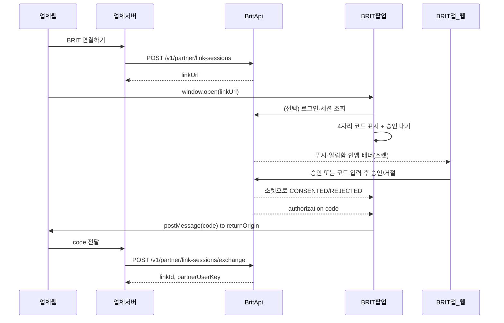
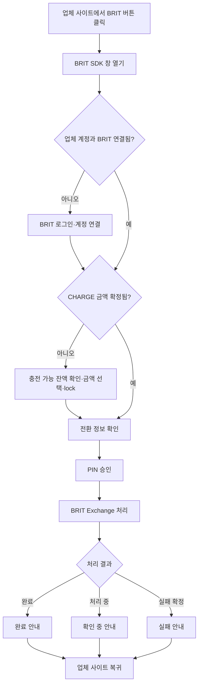
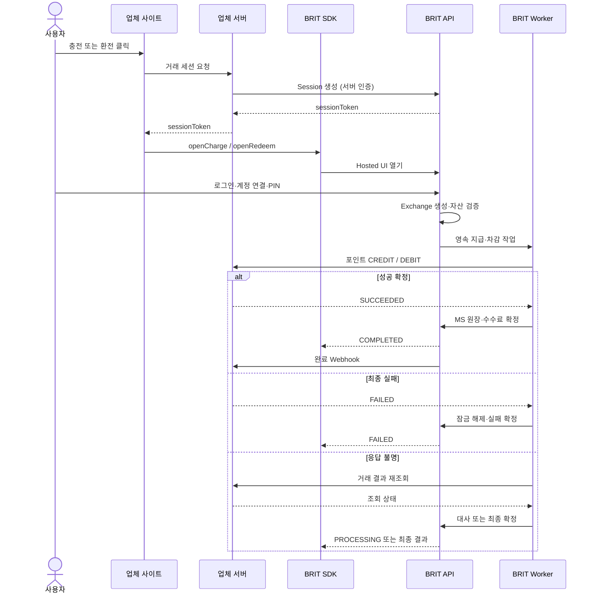

# Merchant Domain (Phase 2 — C2B)

> **문서 상태:** Draft v1.4  
> **대상:** BRIT 사용자·운영자·제휴 업체 개발자·업체 관리자  
> **목적:** 외부 업체와 BRIT MS의 연결, 충전, 환전, 수수료, 정산 및 운영 정책을 정의한다.  
> **설계 기준:** 기존 C2C 거래 도메인과 독립적으로 운영하며, 사용자 Coin/MS 원장은 재사용한다.  
> **생태계·사업 기준:** [`../architecture/brit-ecosystem-v1.md`](../architecture/brit-ecosystem-v1.md) (순잔액≠P2P MS · 수수료≠원금 · D19–D24)  
> **v1.3:** 파트너 SDK 최종 DX — `openCharge` / `openRedeem` · Operations API · Integration Kit (§6.5 · D25)  
> **v1.4:** CHARGE 금액은 파트너 확정이 아니라 Embed에서 잔액 확인 후 lock (§6.4 · §7 · D26)

**관련 문서**
- 생태계 v1: `docs/architecture/brit-ecosystem-v1.md`
- 종합 아키텍처(Phase 1): `docs/architecture/trade-platform-summary.md`
- API 상세: `./api-spec.md` §6
- C2C UX: `../process/trade-payment-ux.md`
- C2C 시나리오: `../process/trade-scenarios.md`

---

## 1. 프로젝트 정의

### 1.1 한 줄 정의

외부 제휴 업체 사용자가 BRIT 계정을 연결하고, 보유한 MS를 해당 업체의 전용 포인트로 충전하거나 업체 포인트를 MS로 환전할 수 있도록 제공하는 **B2B2C 자산 전환 시스템**이다.

BRIT 전체 포지션은 **P2P·파트너 교환 생태계 운영자**이며, C2B의 주수익은 **확정 CHARGE/REDEEM 수수료**다. 현금 P2P를 BRIT가 보관하지 않는다고 중개·원장 책임이 사라지지는 않는다. 상세: `brit-ecosystem-v1.md`.

### 1.2 해결할 문제

| 현재 상황 | 문제 | 시스템 해결 방향 |
|---|---|---|
| 업체마다 별도 포인트 운영 | 서로 다른 포인트를 직접 연동하기 어려움 | BRIT MS를 공통 전환 자산으로 활용 |
| 업체별 독립 회원 계정 | 동일 사용자 식별이 어려움 | 업체 회원과 BRIT 회원 연결 |
| 업체마다 다른 연동 기술 | 개발 및 유지보수 부담 | 공통 SDK 및 API 계약 |
| 서로 다른 자산 원장 | 차감·지급 불일치 위험 | 양측 원장과 전환 상태 관리 |
| 업체별 별도 수수료 | 거래별 수익 추적 어려움 | 수수료 스냅샷 및 정산 원장 |

### 1.3 시스템 책임

**BRIT**
- 업체 Client 인증
- BRIT 사용자 로그인
- 업체 회원 계정 연결
- MS 잔액 및 원장 관리
- 충전·환전 상태 관리
- 외부 지급 결과 검증
- 수수료·정산 관리
- 감사 및 장애 복구

**제휴 업체**
- 업체 회원 인증
- 업체 회원 식별자 제공
- 자체 포인트 잔액 및 원장 관리
- BRIT의 전환 요청에 따른 포인트 지급·차감
- 외부 거래번호 기반 처리 결과 조회
- BRIT Webhook 수신 및 운영 처리

**BRIT SDK**
- 브라우저에서 BRIT Hosted UI(팝업/Embed) 실행 · `postMessage` 결과 수신
- Origin/Source 검증, 취소·오류·닫힘 반환
- **프레임워크 중립**(React 의존 없음). **Secret·원장·Partner HTTP는 담지 않음**
- 파트너 공개 표면은 **충전·환전·상태**만 (§6.5). MS·PIN·수수료·P2P·정산은 BRIT 전담

SDK는 자산 원장을 직접 수정하지 않는다. 배포·최소 API는 §5.0·§6·§6.5.

---

## 2. C2C와 C2B의 차이

| 항목 | C2C (Phase 1) | C2B (Phase 2) |
|---|---|---|
| 거래 상대 | 다른 사용자 | 제휴 업체 |
| 자산 이동 | 사용자 → 사용자 | 사용자 ↔ 업체 |
| 실제 결제 수단 | 원화 계좌이체 | BRIT MS·업체 포인트 |
| 매칭 | 필요 | 불필요 |
| 승인 | 구매자·판매자 | 사용자 PIN·업체 API |
| 완료 조건 | 입금 확인·MS 이전 | MS 원장·업체 원장 처리 확인 |
| 상태 머신 | Trade | Merchant Exchange |
| UI | Trade Activity | BRIT Embed |
| 실패 복구 | 분쟁 중심 | 외부 API 대사 중심 |
| 수익 | MVP 방향: P2P 수수료 0 (`brit-ecosystem-v1` · D24) | **업체별 전환 수수료**(주수익) |

C2C의 `Trade`와 C2B의 `MerchantPayment/Exchange`는 동일한 상태 모델을 사용하지 않는다.

단, MS Wallet / Lot / Ledger는 공통 자산 도메인을 사용한다.

---

## 3. 핵심 사용자 및 역할

| 역할 | 목적 | 책임 |
|---|---|---|
| BRIT 사용자 | 업체 포인트 충전·환전 | 로그인, 연결 동의, PIN 승인 |
| BRIT 운영자 | 제휴 업체 운영 | 업체 승인, Client·수수료·정산 관리 |
| 업체 개발자 | BRIT 연동 구축 | SDK 설치, 서버 API·Webhook 구현 |
| 업체 관리자 | 업체 거래 운영 | 거래 조회, 실패 확인, 정산 조회 |
| 업체 서버 | 외부 자산 처리 | 포인트 예약·지급·차감·결과 조회 |

업체 관리자와 BRIT 일반 사용자 계정은 동일 인물일 수 있지만, 업체 관리 권한과 개인 자산은 별도로 관리한다.

---

## 4. Merchant와 Client 구조

### 4.1 Merchant

`Merchant`는 제휴 업체 자체를 나타낸다.

주요 속성 (`partners`):
- `id`
- `code`
- `name`
- `status`
- `contactName` / `contactPhone` / `contactEmail` / `contactTelegram`
- `memo`
- `createdAt`

상태 (확정):

`ACTIVE ↔ SUSPENDED`, `ACTIVE|SUSPENDED → TERMINATED`  
관리자 등록 시 즉시 `ACTIVE`. 사업자등록번호는 MVP에서 수집하지 않는다.

업체 상태와 Client 상태는 독립적으로 관리한다.

### 4.2 Merchant Client

업체가 BRIT 시스템을 호출하기 위한 인증 단위다.

주요 속성:
- `clientId`
- `merchantId`
- `environment`
- `clientType`
- `status`
- `allowedOrigins`
- `scopes`
- `webhookUrl`

업체 하나가 Sandbox와 Production Client를 각각 가질 수 있다.

### 4.3 API Secret

- Secret은 업체 서버에서만 사용한다.
- 브라우저 SDK에 Secret을 전달하지 않는다.
- 서버에는 Secret 원문 대신 안전한 검증 정보만 저장한다.
- 최초 발급 시 원문을 한 번만 제공한다.
- 회전·폐기 이력을 보존한다.

인증 수단에 따라 API Secret 또는 비대칭키 서명 기반 인증을 사용할 수 있다.

### 4.4 업체 등록 프로세스 (1차 — 관리자 수동)

신청은 메신저·메일로 받는다. 시스템 내 셀프 온보딩은 없다.

1. BRIT 운영자가 관리자 페이지에서 업체 생성 → 즉시 `ACTIVE`
2. 업체 담당자가 일반 회원가입 후 승인(`users.ACTIVE`)
3. BRIT 운영자가 `partner_members`로 사용자↔업체 수동 연결
4. 업체 OWNER가 `brit-partner` 「연동」에서 Sandbox Client 발급 · Origin (Admin도 가능)
5. (후속) 연동 테스트 · Production Client · CHARGE/REDEEM

**1차 담당자 규칙** (`partner_members`)

- 연결 대상은 `users.status = ACTIVE`만
- 사용자당 ACTIVE 소속 업체 **1개**. 이미 소속이면 추가 금지, **재배정(변경)**만
- `SUSPENDED` 업체에도 신규 담당자 추가 가능
- `TERMINATED` 업체에는 추가 불가, 기존 담당자 역할 변경·해제만
- 역할: `OWNER` / `MANAGER`
- 최종 사용자 Embed 동의 연결(`user_partner_links`)은 1차 범위 밖

구현 SoT: `brit-api/docs/p0/p0-partner-admin-onboarding.md`  
정책 요약: `docs/roadmap/partner-onboarding-policy.md`

---

## 5. 업체 계정 연결 (Merchant Account Linking)

> **구분:** §4.4의 `partner_members`는 **업체 담당자(운영자)** 연결이다.  
> 이 절의 연결은 **최종 사용자**가 Embed에서 CHARGE/REDEEM 하기 위한 `user_partner_links`다.  
> (팝업 연결·code 교환·Admin 해제는 구현됨. 사용자 앱의 연결 목록·해제는 후속.)

### 5.0 범용 전제 (확정) — 업체는 BRIT가 아니다

제휴 대상은 **다양한 외부 업체**(게임·커머스·플랫폼 등)다. 대부분 이미 **자체 회원 체계·로그인·회원 키**를 갖고 있다.  
`brit-sample-shop`은 BRIT 제품이 아니라, 그런 업체를 흉내 내는 **연동 샘플**이다.

따라서 기본 통합 모델은 “샵에 BRIT 아이디로 로그인”이 아니라 아래다.

```text
업체 회원 (partnerUserKey)  ←연결→  BRIT 사용자 (userId)
```

| 주체 | 책임 |
|---|---|
| 업체 | 자사 회원 인증·세션. `partnerUserKey`는 **업체 회원 식별자** (형식은 업체마다 다름) |
| BRIT | BRIT 계정 로그인·연결 동의·`user_partner_links`·전환 원장 |
| SDK / Embed | 인증 UI는 BRIT 쪽만. 업체 페이지에 BRIT 비밀번호를 받지 않음 |

**하지 않는 것 (기본 경로)**

- `partnerUserKey`를 BRIT `login_id`로 강제하지 않는다. 업체 회원 시스템을 BRIT에 종속시키기 때문이다.
- 업체 웹에 BRIT 아이디/비밀번호 입력란을 두지 않는다 (피싱·신뢰 경계).
- 샘플 샵의 “데모 회원 키 입력”을 BRIT 로그인과 동일시하지 않는다. 그것은 **업체 로그인 흉내**다.

#### 두 모드

| 모드 | 용도 | `partnerUserKey` | SDK 기본 |
|---|---|---|---|
| **연결 (Link)** | 업체가 이미 회원을 갖고 있음. 구글 “계정 연결”과 동일 | 업체 회원 키 | **기본·범용** |
| **BRIT로 로그인 (IdP, 옵션)** | 업체 회원이 없고 BRIT를 IdP로 씀 | 동의 후 `login_id` 등으로 생성 가능 | **후속·별도 제품** |

문서·샘플·Sandbox SDK는 **연결 모드**만 기준으로 한다. IdP 모드는 요구가 생길 때 별도 API·카피로 분리한다.

#### UX 채널

| 방식 | 기본 여부 | 이유 |
|---|---|---|
| **팝업 + `postMessage(code)`** | 기본 | 3rd-party cookie/`SameSite`에 강하고, OAuth·패스키처럼 “인증만 하고 일회용 값만 반환” |
| iframe | 비기본 | 업체 페이지 내 임베드 UX가 필요할 때만. 세션·쿠키 이슈가 커 SDK 기본으로 두지 않음 |

반환 계약은 패스키/OAuth와 같다. 업체는 **일회용 `code` → `exchange` 결과**만 받고, BRIT 비밀번호·세션 쿠키를 받지 않는다.

#### “일치”의 의미 (확정)

연결 모드는 **두 식별자를 붙이는 것**이지, 문자열이 같아야 한다는 뜻이 아니다.

```text
업체 회원키 (partnerUserKey)  ≠  BRIT login_id
         └──────── link ────────┘
```

| 검증 | 필수? | 담당 | 현재 |
|---|---|---|---|
| **세션 바인딩** — `exchange`로 나온 `partnerUserKey`가 **지금 업체에 로그인한 회원**과 같은지 | **필수** | 업체 서버 | 샘플: `LINK_MEMBER_MISMATCH` |
| **POL-LINK-001** — 해당 업체에서 키·BRIT 유저 1:1 | **필수** | BRIT API | 구현됨 |
| **BRIT 클라이언트 승인** — 로그인된 BRIT(앱·PWA·웹)에서 승인/거절 또는 코드 입력 | **필수 · 구현됨 (P9-1…7)** | BRIT Embed 대기 + BRIT 클라이언트 | §5.2.1 / MC-P9 |
| **동의 UI** — 업체명 + 마스킹 회원 키 표시 | 권장 · 구현됨 | BRIT 승인 화면 | MC-P9 |
| **거래 PIN** — 연결 이후 CHARGE/REDEEM 건마다 | **CHARGE Intent 경로 구현** | Intent/Embed (B3) | 동기 `charge`는 PIN 없음(임시 Sandbox). REDEEM Embed는 B5 |
| **`login_id` === `partnerUserKey`** | **기본에선 하지 않음** | — | IdP 모드 전용(후속) |

잘못된 해석: “샵에 BRIT 아이디를 쳐서 같게 맞춘다.”  
올바른 해석: “이 code가 **내가 연결을 연 그 업체 회원**에 대한 것인지만 확인한다.”

**신뢰 전제와 한계:** 연결은 “업체 세션을 쓸 수 있는 사람”과 “**BRIT 클라이언트에서 승인한 사람**”을 묶는다.  
샵만 탈취한 공격자는 피해자 BRIT 기기/세션 없이는 연결을 끝낼 수 없다.  
신분증 수준의 본인인증은 아니며, BRIT 계정·기기를 함께 가진 경우에는 여전히 연결 가능하다. 돈 이동은 §5.2.2 거래 PIN으로 막는다.

> **레거시 (MC-P7):** 샵에 4자리 표시 → Embed 입력은 **세션 페어링**이었고 본인 일치 증명이 아니었다. **P9-7에서 제거 완료.** 제품 SoT는 §5.2.1(MC-P9).

#### 최소 SDK 표면 (연결 모드 · 확정 방향)

**DX 목표:** 업체 개발자가 **복사할 코드**를 최소화한다. React/Vue/레거시 여부와 무관하게 같은 계약.  
**파트너 공개 최종 표면:** §6.5 (`openCharge` / `openRedeem` / `getStatus`). 아래는 연결·현재 구현(B3) 계약이다.

업체가 붙일 때 Secret은 **업체 서버만**, 브라우저는 공개 `clientId`(선택)와 서버가 준 `sessionToken`/`linkUrl`/`payUrl`만 다룬다.

**연결 — 목표 프론트 사용 (개념 · 현재 구현)**

```text
const result = await openBritLink(() => shopApi.createLinkSession())
if (result.status === 'LINKED') await shopApi.exchangeLinkCode(result.code)
```

> **최종 DX (§6.5):** 파트너는 연결을 별도 필수로 노출하지 않아도 된다.  
> `openCharge` / `openRedeem` 최초 실행 시 Hosted UI가 로그인·계정 연결을 유도한다.  
> `openBritLink`는 사전 연결 UX가 필요할 때만 유지한다.

**브라우저 (공개, Secret 없음)**

- `openBritLink(getLinkUrl): Promise<{ status, code? }>` — 팝업 열고 `postMessage`로 `code` 수신 (현재)
- `openBritPay(getPayUrl)` — CHARGE Intent 팝업 (B3 현재). 최종 이름은 `openCharge` (§6.5)
- `getLinkUrl` / `getPayUrl`은 **업체가 제공**. SDK는 URL을 어디서 만드는지·Secret이 뭔지 모름
- 코어는 **바닐라 JS/TS** (`window.open` · `postMessage`). React 훅/컴포넌트는 SDK에 넣지 않음

**업체 서버 (Secret)**

1. `POST /v1/partner/link-sessions` — body: `{ partnerUserKey, partnerUserLabel?, returnOrigin }` → `{ linkUrl, … }`  
   (`partnerUserKey`는 요청 본문이 아니라 **업체 로그인 세션**에서 꺼내는 것을 권장.  
   **업체 웹에 OTP/코드를 표시하지 않는다.** 표시·승인은 BRIT 팝업·BRIT 클라이언트 책임)
2. `POST /v1/partner/link-sessions/exchange` — body: `{ code }` → `{ linkId, partnerUserKey, linkedAt, … }`
3. 응답 `partnerUserKey`와 현재 세션 회원이 다르면 저장하지 않고 거절
4. (충전·환전) 거래 세션/Intent 생성 → `sessionToken` 또는 `payUrl` 발급.  
   **`partnerUserKey`·거래 유형은 업체 서버에서 고정.** CHARGE **최종 금액**은 Embed에서 잔액 확인 후 `POST …/lock`으로 서버에 고정한다 (§6.4 · §7 · D26).  
   (하위 호환: create에 `amount`를 넣으면 생성 시점에 즉시 확정)

**배포 형태 (같은 API · 소스 하나 → 빌드만 분기)**

| 방식 | 사용 예 | 대상 |
|---|---|---|
| **npm ESM** | `import { Brit } from '@brit/sdk'` 또는 named export | Vite/Webpack/Next 등 번들러 |
| **script / IIFE** | `<script src="…/brit-sdk.min.js">` → `Brit.openCharge(...)` | PHP/JSP·정적 HTML·CDN |
| ESM CDN (후속) | `import` from CDN URL | 모던 정적 페이지 |

- 전역 이름은 짧은 네임스페이스 **`Brit`**.
- 공개 `clientId`(토스 `clientKey`와 유사)는 브라우저에 둘 수 있다. **Client Secret은 절대 브라우저에 두지 않는다** (D17·D25).
- script URL은 **버전 고정**을 권장 (`@0.1.0`). `latest`만 쓰면 깨질 수 있음.

**SDK에 넣지 않는 것**

- 업체 페이지의 BRIT 아이디/비밀번호, iframe 기본 채널, 브라우저 Client Secret, `login_id` 강제 일치
- Client Secret · Partner API 호출 · `partnerUserKey` 저장 · 충전/원장 HTTP · 금액·회원키 임의 수정
- React/Vue 전용 어댑터 패키지 (필요하면 업체가 한 줄 래핑)
- 연결 승인 UI·거래 PIN UI — 승인·PIN은 **BRIT Hosted UI**. SDK는 “창 열고 결과 받기”만
- **P2P 매칭·법인 P2P** — BRIT 플랫폼·법인 계정 영역. 파트너 SDK에 넣지 않음 (§6.5)

**분리·확장**

- 현재(B3): `openBritLink` / `openBritPay`
- 최종(§6.5 · D25): `openCharge` / `openRedeem` / `getStatus` (+ 내부에서 연결 유도)
- 패키지·설치 가이드는 **MC-P5 / B3s 완료**. 소스는 `brit-sdk/` (`@brit/sdk`). 샘플은 `file:../brit-sdk`로 사용.

### 5.1 기본 정책

**POL-LINK-001 — 업체별 계정 1:1 연결 (확정)**

- 한 BRIT 사용자는 동일 업체의 회원 계정 하나만 활성 연결할 수 있다.
- 하나의 업체 회원 계정은 하나의 BRIT 사용자에게만 활성 연결할 수 있다.
- 다른 업체와의 연결 개수에는 제한을 두지 않는다.
- 업체 회원 계정 변경은 기존 연결을 수정하지 않고 신규 연결로 처리한다.
- 연결 해제 후에도 기존 전환 및 정산 이력은 보존한다.
- `partnerUserKey`는 업체 측 식별자다. BRIT `login_id`와 같을 필요는 없다 (§5.0).

| 상황 | 처리 | 오류 코드 |
|---|---|---|
| 같은 사용자·같은 회원 키 재요청 | 기존 ACTIVE 연결 반환 (동의 재요구 없음) | — |
| 이미 같은 업체 다른 회원 키와 ACTIVE 연결된 사용자 | **거절.** 기존 연결 해제 후 재시도 안내 | `PARTNER_USER_ALREADY_LINKED` |
| 다른 BRIT 사용자에게 ACTIVE 연결된 회원 키 | 거절 | `PARTNER_USER_LINK_ALREADY_EXISTS` |
| 연결 해제 | 행을 `UNLINKED`로 남김. 같은 키·사용자로 신규 연결 가능. 업체는 `GET /partner/user-links/:key`로 ACTIVE 재확인 | — |
| 해제 시 진행 중인 전환 | **해제 허용.** 시작된 전환은 시작 시점 연결로 끝까지 처리, 이후 신규 전환만 차단 | `PARTNER_USER_LINK_NOT_FOUND` (신규) |

DB: `user_partner_links`에 `status = 'ACTIVE'` 부분 유일 인덱스 2개 — `(partner_id, partner_user_key)`, `(partner_id, user_id)`.  
전환(`partner_exchanges.user_partner_link_id`)은 해제된 연결 행도 계속 참조한다.

BRIT 계정 하나는 여러 업체 계정과 연결할 수 있다.

예시:

| BRIT User | Merchant | Merchant Member | Status |
|---|---|---|---|
| USER-001 | SHOP-A | A-123 | ACTIVE |
| USER-001 | SHOP-B | B-456 | ACTIVE |
| USER-001 | SHOP-C | C-789 | ACTIVE |

업체별 연결은 독립적으로 생성·해제한다.

### 5.2 최초 연결 프로세스 (구현: OAuth authorization code 방식)

구글 서드파티 **계정 연결**과 같은 구조다 (§5.0 연결 모드).  
전제: 사용자는 이미 **업체 사이트에 업체 회원으로 로그인**한 상태다.  
연결은 **사용자 동의 시점**에 생기고, 업체 서버가 Secret으로 code를 교환해 확정을 확인한다.

**제품 정책 (확정):**

| 단계 | 수단 | 상태 |
|---|---|---|
| 최초 연결 | **BRIT 클라이언트 승인** (§5.2.1) | 확정 · **구현됨** (MC-P9 P9-1…7). 레거시 MC-P7 제거 완료. P9-8 푸시는 선택 |
| 연결 이후 충전·환전 | **거래 PIN** 건마다 (§5.2.2, B3) | CHARGE Intent+Embed PIN 구현. 동기 `charge`/`redeem`은 PIN 없음(Sandbox) |



1. 사용자가 **업체** 홈페이지에 **업체 회원**으로 로그인한다. (BRIT 아이디 입력이 아님)
2. 「BRIT 연결하기」(또는 첫 충전)를 누른다.
3. 업체 서버가 **현재 세션의** `partnerUserKey`·표시명·`returnOrigin`으로 연결 세션을 만든다. `returnOrigin`은 해당 Client에 등록된 Origin만 허용한다.
4. SDK가 `brit-front` `/embed.html#session=…` **팝업**을 연다. 토큰은 URL fragment로만 전달하고 팝업이 즉시 주소창에서 지운다. **업체 웹에는 코드를 표시하지 않는다.**
5. 팝업은 (필요 시) BRIT 로그인을 받은 뒤 **4자리 연결 코드를 크게 보여 주고 승인 대기**한다. 실시간 상태는 **소켓**으로 받는다(폴링 비권장).
6. 사용자는 **이미 로그인된 BRIT 클라이언트**(폰 앱·설치 PWA·데스크탑 브라우저 탭)에서 승인한다 (§5.2.1). 업체 페이지는 BRIT 비밀번호를 받지 않는다.
7. BRIT이 POL-LINK-001 기준으로 상태를 판정한다 — `NEW` / `ALREADY_LINKED_SAME` / `CONFLICT_OTHER_KEY` / `CONFLICT_KEY_TAKEN`. 충돌이면 연결하지 않고 안내한다. (`ALREADY_LINKED_SAME`은 재승인 생략 가능)
8. BRIT 클라이언트에서 승인되면 `user_partner_links`를 만들고, 팝업이 1회용 authorization `code`를 `returnOrigin`으로 `postMessage`한다.
9. 업체 서버가 code를 교환해 `partnerUserKey`가 **현재 업체 세션 회원**과 같은지 확인한 뒤 연결 상태를 저장한다.
10. 이후 충전·환전은 **건마다 BRIT PIN**으로 승인한다 (§5.2.2, B3). Sandbox 동기 API만 있는 동안은 PIN 없이 동작할 수 있으나 운영 경로로 쓰지 않는다.

세션 토큰·authorization code·연결 코드는 DB에 SHA-256 해시만 저장한다(`partner_link_sessions`).  
상태: `PENDING` → (BRIT 클라이언트 승인) → `CONSENTED` → `EXCHANGED`, 또는 `REJECTED` / `EXPIRED`.

#### 5.2.1 BRIT 클라이언트 승인 — 앱·웹 승인 (확정 · MC-P9 P9-1…7 완료)

**목적:** 연결 확정을 **BRIT에 로그인된 클라이언트**(앱·PWA·데스크탑 웹)에서만 하게 한다.  
업체는 `openBritLink`만 쓰고, OTP/승인 UI를 만들지 않는다. (넥슨 플러그형: PC/팝업에 코드·대기, 승인 앱·웹에서 처리)

**약속 문구:** “BRIT 기기·세션에서 승인한 연결”이다. 신분증 본인확인·KYC가 아니다.

**UX 원칙**

- 이탈 일부는 감수한다. 대신 BRIT 쪽 진입·승인 UI를 단순하게 유지한다.
- **푸시는 가속 장치**다. 실패해도 같은 요청이 **알림함**과 **열린 BRIT 화면의 배너/시트**에 남는다.
- **데스크탑도 1급 클라이언트**다. 폰 전용이 아니라, 팝업 옆 BRIT 탭/PWA에서도 승인·코드 입력이 가능해야 한다.
- 실시간 동기화는 **소켓**을 기본으로 한다(팝업 대기, 인앱 배너/알림함 갱신). 폴링은 폴백(P9-2 임시 허용).

##### 보안 계약 (P9-0 · 구현 필수)

| 규칙 | 내용 |
|---|---|
| **팝업 claim 필수** | Embed에서 BRIT 로그인 후 `claimedUserId`를 세션에 고정한다. 다른 사용자가 이미 claim한 세션은 거절 |
| **코드 표시 시점** | claim **이후**에만 팝업에 4자리 표시. 업체 create 응답의 평문 코드는 쓰지 않음(레거시 제거) |
| **코드 조회 범위** | `by-code`는 **전역 PENDING 검색 금지**. `claimedUserId === 현재 userId`인 세션만 해시 대조 |
| **승인 주체** | approve/reject는 claim된 사용자와 동일 계정만. 알림·배너도 그 userId에게만 |
| **4자리 브루트포스** | 위 claim 스코프 + 세션당 5회 + TTL 3분. claim 없는 코드는 승인 경로에 진입 불가 |
| **팝업 조기 종료** | 팝업을 닫으면 샵이 `postMessage(code)`를 못 받을 수 있다. 카피: “승인될 때까지 이 창을 닫지 마세요”. 후속: 샵 측 연결 상태 조회(별도) |

##### 제품 표

| 항목 | 정책 |
|---|---|
| 사용 시점 | **최초 연결(NEW)만.** `ALREADY_LINKED_SAME`은 팝업에서 재승인·코드 생략 가능 |
| 팝업 역할 | ① 로그인(claim) ② 코드 **표시** ③ “BRIT에서 승인해 주세요” + 대기. **최종 승인 CTA 없음** |
| 연결 코드 | 숫자 **4자리**. 팝업만 표시. 업체 웹 표시 **금지** |
| 승인 경로 (우선순위) | ① 열린 BRIT **배너/시트** → ② **알림함** → ③ OS/PWA **푸시**(선택) → ④ **코드 수동 입력** |
| 승인 화면 | 업체명·마스킹 회원 키 + **승인 / 거절** |
| 저장 | `pairing_code_hash` (+ 팝업 표시용 평문은 claim 후 Embed에만, 종료 시 삭제). `claimed_user_id` / `claimed_at` |
| 만료 | 세션 TTL **3분**. `EXPIRED` 시 팝업·BRIT 문구 통일. Embed에 줄어드는 타이머 막대 |
| 시도 | 코드 입력 최대 **5회** / 세션 |
| create 응답 | `{ linkUrl, expiresAt, … }`. 업체용 `pairingCode` **없음** |
| 소켓 (P9-4) | `link_session.pending` / `approved` / `rejected` / `expired` |
| 알림 (P9-5) | **claim 이후**에만 해당 userId 알림함 생성 |

##### API 스케치 (P9-1+)

```text
# Embed (JWT + sessionToken)
POST /v1/embed/link-sessions/:token/claim     # claimedUserId 고정 · 코드 평문 1회/조회용
GET  /v1/embed/link-sessions/:token           # 상태·코드(claim 후)·linkState
GET  /v1/embed/link-sessions/:token/events    # SSE link_session (승인·거절·만료)
GET  /v1/embed/link-sessions/:token/wait      # 상태 1회·SSE 폴백

# BRIT 클라이언트 (JWT)
POST /v1/me/partner-link-approvals/preview    # { pairingCode } | { sessionId }
POST /v1/me/partner-link-approvals/approve    # { pairingCode } | { sessionId }
POST /v1/me/partner-link-approvals/reject
```

##### 구현 블록

| ID | 범위 | Done |
|---|---|---|
| **P9-0** | 본 절 계약 | ✅ 문서 합의 (본 절) |
| **P9-1** | claim·승인 API | ✅ |
| **P9-2** | Embed 코드+대기 UI | ✅ 팝업 표시·SSE 대기(폴링 폴백) |
| **P9-3** | BRIT 코드 입력 화면 | ✅ `PartnerLinkApprove` · 알림 deepLink |
| **P9-4** | 소켓(SSE) | ✅ Embed `/events` · 폴링은 폴백만 |
| **P9-5** | 알림함 | ✅ claim 후 `PARTNER_LINK_APPROVAL_REQUESTED` |
| **P9-6** | 인앱 배너 | ✅ 기존 글로벌 배너 + deepLink |
| **P9-7** | 레거시 제거 | ✅ 샵 OTP·create 평문·Embed consent pairing 삭제 |
| **P9-8** | 웹 푸시 | 선택 · 미착수 (`push: false`) |

##### 1차 수용 시나리오 (S1)

1. 샵 회원 로그인 → 연결하기 → 팝업 claim(BRIT 로그인) → 코드 표시  
2. 다른 BRIT 탭에서 코드 입력(또는 알림/배너) → 승인  
3. 팝업이 code를 샵에 전달 → exchange → 연결됨  

P9-1…7 기준 S1은 코드·알림함·배너·SSE로 수용. P9-8 푸시는 선택 확장.

**승인(코드·알림)이 증명하는 것:** claim된 BRIT 계정의 클라이언트에서 이 link-session을 확정했다.  
**증명하지 않는 것:** 신분증 본인인증. 샵+공격자 BRIT를 모두 가진 경우(S8)는 막지 않음 → 거래 PIN·연결 목록 해제로 완화.

**레거시 MC-P7:** 샵 표시 → Embed 입력. **P9-7에서 제거 완료.** Embed consent는 ALREADY_LINKED_SAME만 유지.

**함께 둘 것:** 연결 목록·해제(B2), 거래 PIN(§5.2.2), (선택) 샵 재인증.

백로그: **MC-P9** P9-1…7 **완료**. P9-8(웹 푸시)만 선택.

#### 5.2.2 거래 PIN — 연결 이후 건마다 (확정 · CHARGE 구현)

**목적:** 연결만으로 MS·포인트가 움직이지 않게 한다. “연결은 한 번, 돈 이동은 매번 승인.”

| 항목 | 정책 |
|---|---|
| 사용 시점 | ACTIVE 연결 이후 **CHARGE / REDEEM 매 건** |
| UI | Intent + Embed `/embed-pay.html#intent=` 에서 PIN (B3) |
| Sandbox 동기 `POST /partner/exchanges/charge\|redeem` | 개발·연동 검증용. **PIN 없음 → 운영 공개 경로로 쓰지 않음** |

백로그: **B3** CHARGE Intent+PIN 완료(샘플 포함). **MC-P5** `@brit/sdk` 완료. REDEEM Embed는 B5.

### 5.3 재방문

기존 연결이 ACTIVE이고 연결 당사자가 동일하면 연결 동의를 재요구하지 않는다.

단, 거래 승인은 별도로 수행한다.

### 5.4 연결 해제

사용자가 연결을 해제하면 이후 신규 전환 요청을 제한한다.

기존 완료 거래, 정산 근거와 감사 이력은 유지한다.

진행 중인 전환이 있을 경우 연결 해제가 해당 거래의 복구 책임을 없애서는 안 된다.

**클라이언트 UX:** 마이 → 연결된 업체 목록은 상세 확인용이다. 목록 탭만으로 해제하지 않고, 상세 바텀시트 → 최종 확인(Alert) 후 `POST /v1/me/partner-links/:id/revoke`를 호출한다. 연결 코드 승인은 보조 경로(SDK 연결이 기본)다.

### 5.5 연결 예외

- BRIT 로그인 실패
- 사용자 연결 동의 거부
- 업체 회원 식별자 변경
- 이미 다른 BRIT 회원에 연결된 업체 계정
- 업체 Client 정지
- 연결 세션 만료
- 사용자 계정 정지
- 연결 해제 후 재연결

동일 업체 다중 회원 계정 연결은 POL-LINK-001에 따라 허용하지 않는다.

---

## 6. SDK 및 Embed 구조

> **계약의 기준은 §5.0 · §6.5(최종 DX).** 이 절은 책임 경계·배포·Embed 과업·파트너 공개 API를 정리한다.  
> `@brit/sdk` 패키지: `brit-sdk/` (ESM + IIFE). 설치·예시는 `brit-sdk/README.md`. 샘플은 `file:../brit-sdk`.

### 6.1 SDK의 책임

SDK는 업체 브라우저에서 BRIT Hosted UI를 **쉽게 띄우고 결과만 받기** 위한 **얇은** Web 라이브러리다.

**파트너가 이해해야 할 핵심:** 스크립트 설치 → BRIT 창 열기 → (업체 서버) 포인트 처리.  
업체 개발자는 MS 원장·PIN·수수료·P2P·정산 구조를 몰라도 된다.

**하는 일**
- 사용자 클릭 직후 Hosted UI 오픈(차단 완화) → 서버가 준 `sessionToken`/`linkUrl`/`payUrl`로 이동
- `postMessage` Origin·Source 검증
- 연결·충전·환전 결과 상태 반환 (`COMPLETED` / `PROCESSING` / `FAILED` 등)
- (후속) 모바일에서 팝업 불가 시 리다이렉트 채널

**하지 않는 일**
- Client **Secret**을 브라우저에 둠 · Partner API HTTP · 원장 수정 · `partnerUserKey` 저장
- React/Vue 컴포넌트 강제
- iframe을 기본 채널로 제공
- P2P·수수료 계산·정산 UI

자산 원장은 업체 서버 + BRIT API가 수정한다. SDK는 원장을 건드리지 않는다.  
`onResult` / `postMessage`는 **UI용 신호**일 뿐, 포인트 지급·차감의 증거가 아니다. 실제 성공은 업체 서버↔BRIT 거래 기록으로 판단한다 (§8·§11).

### 6.2 사용 예시 (연결 · npm · 현재 B3)

```typescript
import { openBritLink } from "@brit/sdk";

button.addEventListener("click", async () => {
  const result = await openBritLink(async () => {
    const session = await shopApi.createBritLinkSession(); // 업체 서버
    return session.linkUrl;
  });
  if (result.status === "LINKED") {
    await shopApi.exchangeBritLinkCode(result.code); // 업체 서버 → BRIT exchange
  }
});
```

### 6.2.1 사용 예시 (연결 · script 태그 · 현재 B3)

```html
<script src="https://cdn.example.com/brit-sdk@0.1.0/brit-sdk.min.js"></script>
<script>
  document.getElementById("link").onclick = async () => {
    const result = await Brit.openBritLink(async () => {
      const session = await shopApi.createBritLinkSession();
      return session.linkUrl;
    });
    if (result.status === "LINKED") {
      await shopApi.exchangeBritLinkCode(result.code);
    }
  };
</script>
```

npm·script는 **동일 API**. 업체 서버가 Secret으로 link-session을 만들고, SDK는 팝업만 연다.  
충전(Intent·PIN) 현재 패턴: 서버가 Intent URL 발급 → `openBritPay` → 결과만 수신 (B3).  
**최종 파트너 표면은 §6.5** (`openCharge` / `openRedeem`).

### 6.3 팝업 · iframe · 리다이렉트

| 방식 | 기본? | 비고 |
|---|---|---|
| **데스크톱/모바일 팝업 + `postMessage`** | **기본** | §5.0. 3rd-party cookie에 강함 |
| 모바일 풀페이지 리다이렉트 | 후속 | 팝업 차단·OS WebView 대비 |
| iframe | **비기본** | 임베드 UX가 필요할 때만. 세션·쿠키 이슈가 커서 SDK 기본에 두지 않음 |

iframe의 인증 세션이 항상 유지된다고 가정하지 않는다. Hosted UI는 팝업을 기본으로 한다.

### 6.4 Embed 내 사용자 과업

팝업(또는 후속 리다이렉트) 안에서 사용자가 하는 일:

1. BRIT 로그인(팝업 또는 BRIT 클라이언트)
2. (최초 연결) 팝업은 코드·대기, **BRIT 클라이언트에서 승인/거절** (§5.2.1)
3. (CHARGE · 금액 미확정 Intent) **충전 가능 잔액** 확인 후 금액 입력(초안). 확인 화면으로 넘어가도 아직 lock하지 않음 → 뒤로가기로 금액 수정 가능  
   - 라벨: `충전 가능 잔액` (= 현행 판매 불가/nonSellable MS. §12.5)
4. (충전·환전) 요청 업체·Brit 차감·받을 포인트 확인 (수수료는 사용자 Embed에 표시하지 않음 — 정산 accrual). Intent 승인 기한은 임박 시에만 노출
5. 「충전 승인하기」 시 `POST /v1/embed/intents/:id/lock`으로 금액 서버 고정 → 거래 PIN (§5.2.2). lock 이후 금액 변경 불가(바꾸려면 취소 후 새 Intent)
6. 처리 진행·완료·실패 안내 (`PAYMENT_PROCESSING` 중 팝업 닫아도 서버 SoT 유지 · 최종은 status/Webhook)

업체가 사용자 BRIT 잔액을 직접 조회하는 API는 MVP에서 제공하지 않는다. 잔액·금액 입력은 **BRIT Hosted UI** 책임이다.

### 6.5 파트너 연동 최종 DX (D25)

> **결정 (D25):** 업체에는 **토스페이먼츠형** 최소 연동만 공개한다.  
> JS SDK + BRIT Hosted UI + 업체 서버 Operations API 2개 + 거래 세션 생성 + Webhook.  
> B3의 Embed·PIN·`openBritPay` 골격을 재사용하고, B4 잠금·확정·Webhook·대사를 수용한다.  
> **구현 상태:** 문서 SoT. 현재 패키지는 `openBritLink` / `openBritPay`(B3). 이름·세션 토큰 DX는 B4/B5와 함께 수렴.

#### 6.5.1 설계 원칙

| 원칙 | 내용 |
|---|---|
| 최소 공개 표면 | 파트너는 `openCharge` · `openRedeem` · `getStatus`만 알면 됨 |
| 서버 고정 세션 | `partnerUserKey`·거래 유형은 업체 백엔드가 세션/Intent 생성 시 고정. CHARGE **최종 금액**은 Embed `lock` 후 서버 고정(또는 create 시 `amount` 호환). 브라우저에서 임의 변조 불가 |
| 자동 계정 연결 | 회원가입 시 사전 연결 불필요. 최초 `openCharge`/`openRedeem`에서 Hosted UI가 유도 |
| 책임 분리 | PIN·MS·수수료·정산·P2P = BRIT / 포인트 지급·차감 = 업체 서버 |
| UI ≠ 원장 | SDK `onResult`는 UI 신호. 완료 기준은 업체 결과 확인 + BRIT 원장 확정 |

```text
업체 사이트 ──SDK──▶ BRIT Hosted UI (로그인·연결·PIN·Exchange)
     │                      │
     │                      ▼
     │                 BRIT Worker ──▶ 업체 Operations API (CREDIT/DEBIT)
     ▼
업체 서버 (세션 생성 · Webhook 수신 · 포인트 원장)
```

#### 6.5.2 SDK 공개 API (3개)

| SDK 기능 | 업체에서 하는 일 | BRIT에서 하는 일 |
|---|---|---|
| `openCharge()` | MS → 포인트 충전창 열기 | 로그인·연결·PIN·잔액·CHARGE |
| `openRedeem()` | 포인트 → MS 환전창 열기 | 로그인·연결·PIN·REDEEM |
| `getStatus()` | 전환 결과 조회(UI) | Exchange/Intent 상태 반환 |

```typescript
import { Brit } from "@brit/sdk";

const brit = new Brit({
  clientId: "brit_partner_abc", // 공개 키. Secret 아님
});

// MS → 업체 포인트
await brit.openCharge({
  sessionToken: chargeSessionToken, // 업체 서버가 BRIT에서 발급
  onResult: ({ status }) => {
    // COMPLETED | PROCESSING | FAILED — UI용
    // 실제 포인트 반영은 업체 서버(Operations / Webhook)에서
  },
});

// 업체 포인트 → MS
await brit.openRedeem({
  sessionToken: redeemSessionToken,
  onResult: ({ status }) => {
    console.log(status);
  },
});
```

| 현재(B3) | 최종(D25) | 비고 |
|---|---|---|
| `openBritLink` | (선택) 사전 연결 / Hosted UI 내부 유도 | 파트너 필수로 노출하지 않음 |
| `openBritPay` + CHARGE Intent | `openCharge({ sessionToken })` | 회원키·유형 서버 고정 · 금액은 Embed lock(또는 create amount) |
| (없음 · B5) | `openRedeem({ sessionToken })` | REDEEM Embed |
| Intent `GET` | `getStatus()` | UI 폴링·복귀 후 조회 |

**보안**

- `clientId`는 공개 식별자다. **Client Secret은 업체 서버만**.
- `sessionToken`은 짧은 수명. 유형·`partnerUserKey`는 세션/Intent에 서버 측 고정. CHARGE 금액은 Embed `lock`(JWT 사용자) 또는 create `amount`로만 고정.
- 브라우저에서 미lock 금액을 바꿔 authorize하거나, 타 사용자 포인트를 조작하는 구조를 허용하지 않는다.

#### 6.5.3 사용자 경험 (Hosted UI)



| SDK 상태 | 사용자에게 보여줄 내용 |
|---|---|
| `COMPLETED` | 충전·환전이 완료되었습니다 |
| `PROCESSING` | 처리 결과를 확인하고 있습니다 |
| `FAILED` | 전환하지 못했습니다. 자산 상태를 확인해 주세요 |

`FAILED`는 **실제 실패가 확정**되고 필요한 자산 복구가 끝난 경우에만 반환한다. 결과 불명은 `PROCESSING`을 유지한다 (§8.4·§11).

#### 6.5.4 업체 서버 — Operations API 2개 (B4 필수)

B4 모델 A를 유지하려면 업체가 포인트 지급·차감을 처리해야 한다.  
CHARGE/REDEEM을 업체마다 다르게 요구하지 않고 **공통 Operations**로 표준화한다 (§8.5와 동일 계약).

| API (업체 서버가 구현 · BRIT가 호출) | 역할 |
|---|---|
| `POST /brit/operations` | 포인트 지급(`CREDIT`) 또는 차감(`DEBIT`) |
| `GET /brit/operations/:exchangeId` | 해당 요청의 실제 처리 결과 조회 |

**① 포인트 처리 요청 예**

```json
{
  "exchangeId": "EX-20261116-001",
  "operation": "CREDIT",
  "partnerUserKey": "USER-1234",
  "amount": 50000,
  "assetCode": "SHOP_POINT"
}
```

- `CREDIT`: CHARGE — 업체 포인트 지급
- `DEBIT`: REDEEM — 업체 포인트 차감

**① 응답 예**

```json
{
  "exchangeId": "EX-20261116-001",
  "partnerTransactionId": "SHOP-TX-500",
  "status": "SUCCEEDED",
  "processedAt": "2026-11-16T03:00:00+09:00"
}
```

- `exchangeId`로 **멱등**. 동일 요청 재전송 시 포인트는 한 번만 반영하고 최초 결과를 재반환한다.
- 동일 ID에 다른 금액·방향이 오면 중복 성공으로 반환하지 말고 **충돌 거절**.

**② 처리 결과 조회**

`GET /brit/operations/:exchangeId` — 타임아웃·장애 시 BRIT Worker가 재조회한다.

| 결과 | 의미 | BRIT 처리 |
|---|---|---|
| `SUCCEEDED` | 지급·차감 확정 | 내부 MS 확정 |
| `FAILED` | 최종 실패 확정 | 잠금 해제 또는 지급 중단 |
| `PROCESSING` | 업체 처리 중 | 대기 후 재조회 |
| `NOT_FOUND` | 해당 거래 기록 없음 | 미처리로 단정하기 전 검증 필요 |
| `UNKNOWN` | 결과 불명 | 대사 유지 |

`NOT_FOUND`만으로 무조건 실패 확정하지 않는다. 기록 반영 지연이 있을 수 있다.

추가로 업체는 **거래 세션 생성**(Secret으로 BRIT 호출)과 **Webhook 수신**을 구현한다.

#### 6.5.5 전체 서버 처리 흐름



REDEEM은 CHARGE와 자산 확보 순서가 다르다. 업체 포인트 차감(`DEBIT`) 확인 후 BRIT MS를 지급하며, 지급 전 업체 가용 한도·준비금 정책을 검증한다 (§12 · B5).

#### 6.5.6 Partner Integration Kit

BRIT가 파트너에 제공하는 구성:

| # | 구성 | 내용 |
|---|---|---|
| ① | JavaScript SDK | Hosted UI 열기 · 계정 연결 유도 · 처리 상태 반환 |
| ② | 서버 연동 API 명세 | 거래 세션 생성 · Operations · 결과 조회 |
| ③ | Webhook | 완료·실패 통지 (서명·재시도) |
| ④ | 샘플 서버 패키지 | NestJS/Express 멱등·서명 검증 예제 (**추천**) |
| ⑤ | Sandbox | 정상·중복·타임아웃·장애 복구 검증 |

샘플 패키지는 업체 포인트 테이블에 연결하는 부분만 바꾸면 되도록 제공한다.  
단, 업체 트랜잭션과 **직접 결합**되어야 하며, 패키지 설치만으로 자동 정합성이 보장되지는 않는다.

#### 6.5.7 파트너가 실제로 하는 일

| 작업 | 업체 | BRIT |
|---|---|---|
| Client ID 발급 | 발급 신청 | 발급·권한 설정 |
| SDK 설치 | 스크립트 또는 NPM | SDK 제공 |
| 거래 세션 생성 | 백엔드에서 BRIT 호출 | 검증·세션 발급 |
| 충전·환전 버튼 | `openCharge` / `openRedeem` | Hosted UI |
| 사용자 로그인·PIN | 구현 불필요 | 전담 |
| MS 잔액·Lot | 구현 불필요 | 전담 |
| 업체 포인트 지급·차감 | Operations API 1개 | 요청·검증 |
| 업체 포인트 처리 조회 | Operations 조회 1개 | 자동 대사 |
| 거래 완료 통지 | Webhook 수신 | 서명·재시도 |
| 수수료·정산서 | 조회·입금 | 계산·생성·확정 |
| P2P 매칭 | 구현 불필요 · **SDK에 넣지 않음** | BRIT 플랫폼·법인 계정 |

#### 6.5.8 연동 수준

| 수준 | 구성 | 대상 |
|---|---|---|
| **Standard (추천 / MVP)** | SDK + Operations 2개 + 세션 생성 + Webhook | 대부분 업체. B4 원칙에 맞음 |
| **Advanced (후속)** | 예약·확정 2단계 · 배치 대사 · 환불 · 한도 · 다중 자산 | 거래량·복잡도 높은 업체 |

업체 서버 API 없이 브라우저만으로 포인트를 지급·차감하는 구조는 허용하지 않는다.

#### 6.5.9 최종 정책 요약

| 구분 | 정책 |
|---|---|
| 설치 | CDN Script 또는 NPM |
| UI | BRIT Hosted UI (팝업 기본 · iframe 비기본) |
| 주요 함수 | `openCharge`, `openRedeem`, `getStatus` |
| 거래 세션 | 업체 백엔드가 생성 |
| 업체 연결 | 최초 실행 시 Hosted UI가 자동 유도 |
| PIN·자산 인증 | BRIT 전담 |
| 포인트 지급·차감 | 업체 백엔드 전담 |
| MS 원장·정산 | BRIT 전담 |
| 완료 기준 | 업체 결과 확인 + BRIT 원장 확정 |
| 실패·타임아웃 | BRIT Worker · Reconciliation |
| Webhook | 완료 후 상태 통지 |
| P2P | SDK와 분리 · BRIT 플랫폼 |
| 업체 법인 P2P | 별도 법인 계정·권한 (D21) |

**추천 한 줄:** 업체에는 `openCharge()`와 `openRedeem()`만 보여주고, 복잡한 일은 BRIT가 처리한다.  
자산 정합성을 위해 업체 백엔드에는 Operations(지급·차감·조회) 책임이 남는다.

---

## 7. Merchant Payment Intent

> **상태:** B3 CHARGE Intent + Embed PIN 구현. `@brit/sdk`(`openBritPay`)는 MC-P5 완료.  
> Sandbox 동기 전환 §17 `POST /v1/partner/exchanges/charge|redeem`은 PIN 없이 유지(검증용).

### 7.1 정의

`MerchantPaymentIntent`는 업체가 사용자에게 BRIT MS 충전을 요청하기 위해 생성하는 **일회성 거래 의도**다.

Intent는 실제 자산 이전 결과와 구분한다.

### 7.2 생성 주체

업체 백엔드.

### 7.3 필수 데이터 (구현 필드)

- `intentId`
- `partnerId` / `partnerClientId` (인증 Client에서 결정)
- `externalOrderId`
- `partnerUserKey`
- `chargeAmountMs` / `feeAmountMs` / `totalDebitMs` — **create 시 `amount` 생략이면 null** (Embed lock 후 스냅샷)
- `amountLockedAt` — create에 amount가 있거나 Embed lock 성공 시 설정
- `returnOrigin`
- `status` · `expiresAt` · `createdAt`
- `assetCode?` · `metadata?`

업체 회원 식별자(`partnerUserKey`)는 업체 서버에서 인증한 값으로 고정한다.

### 7.4 Intent 생성 API (B3 · SoT = §17)

인증: `X-Partner-Client-Id` + `X-Partner-Api-Secret` (SERVER, scope `EXCHANGE_CHARGE`)

```http
POST /v1/partner/payments/intents
```

Request (권장 · 금액은 Embed에서 확정):

```json
{
  "externalOrderId": "shop-order-991",
  "partnerUserKey": "A-123",
  "returnOrigin": "https://shop.example",
  "assetCode": "POINT",
  "metadata": {
    "productName": "게임 포인트 충전"
  }
}
```

`amount`는 **optional**. 넣으면 생성 시점에 즉시 lock(하위 호환).

Response (무금액):

```json
{
  "intentId": "mpi_xxx",
  "payUrl": "https://brit.app/embed-pay.html#intent=mpi_xxx",
  "chargeAmountMs": null,
  "feeAmountMs": null,
  "totalDebitMs": null,
  "status": "CREATED",
  "expiresAt": "2026-11-03T12:00:00Z",
  "expiresInSec": 600
}
```

업체는 인증된 Client로 결정된다. 팝업은 `payUrl`을 `openBritPay`로 연다.

#### Embed 금액 lock

```http
POST /v1/embed/intents/:id/lock
Authorization: Bearer <user JWT>
```

```json
{ "amount": "275000" }
```

- Intent `CREATED` · 미만료 · 링크된 사용자만
- 충전 가능 잔액(nonSellable) ≥ amount
- 수수료 스냅샷 후 `amount` / `totalDebit` / `fee*` / `amountLockedAt` 저장
- 동일 금액 재호출은 멱등. **다른 금액**이면 `PARTNER_PAYMENT_INTENT_AMOUNT_LOCKED`
- lock 후 `authorize` 가능. 미lock `authorize`는 거절

### 7.5 Intent 멱등성

- 같은 업체의 같은 `externalOrderId`는 동일 거래로 식별한다.
- 같은 주문번호에 `partnerUserKey` / `assetCode` / **확정 금액(또는 무금액)** 이 다르면 거절한다.
- Embed lock으로 금액이 정해진 뒤 다른 금액 lock은 거절한다.
- 이미 완료된 Intent는 다시 처리하지 않는다.
- HTTP 재시도는 기존 결과를 반환한다.

---

## 8. Merchant Payment 및 충전 프로세스

### 8.1 CHARGE 정의

사용자의 BRIT MS를 차감하고, 해당 업체가 관리하는 포인트를 지급한다.

**전제:** 1 MS = 1포인트 상당으로 가정한다.

### 8.2 정상 흐름

> **결정 (D18):** B4 공식 SoT는 **모델 A** — 업체 포인트 지급을 **확인한 뒤** MS를 확정 차감한다.  
> **B3**는 PoC/Sandbox(모델 B: MS 즉시 차감 → 업체 `confirm` 후행 적립). **운영 경로로 쓰지 않는다.**  
> Embed·PIN·`openBritPay`는 B3/B4 공통. B4는 `authorize` **이후** 자산 파이프만 교체한다. 코드 착수 전 문서 SoT.

| | B3 (PoC · 구현됨) | B4 (공식 · 미구현 · 모델 A) |
|---|---|---|
| PIN 후 | 동기 CHARGE로 MS **즉시 차감** | MS **잠금**만 |
| 업체 포인트 | 업체가 Intent `COMPLETED` 조회 후 `confirm` | BRIT가 업체 **credit API** 호출 |
| MS 확정 | authorize와 동일 요청 | 업체 지급 **성공 확정 후** |
| 실패 시 | 업체 미적립 → 재시도·환불 책임 | 실패 확정 시 **잠금 해제** / 불명은 대사 |
| Webhook | 없음 | 확정 **통지**(지급 실행 아님) |

**운영 원칙 (모델 A):** 업체 포인트 지급이 확정되지 않은 상태에서는 BRIT MS를 **확정 차감하지 않고**, 결과 불명일 때 **임의로 잠금 해제하지 않는다.**

#### 현재 구현 (B3/B4 Embed · 금액 Embed 확정)

| 단계 | 주체 | 처리 |
|---|---|---|
| 1 | 사용자 | 샵에서 「BRIT으로 충전」(금액 없음) |
| 2 | 업체 서버 | `POST /v1/partner/payments/intents` (**amount 생략**) → `payUrl` |
| 3 | 사용자 | `openBritPay` · 로그인 · **충전 가능 잔액 확인 · 금액 입력 · 확인 · lock · PIN** |
| 4 | BRIT | `authorize` → MS 잠금 + Outbox (B4) / PoC 동기 CHARGE(레거시) |
| 5 | 팝업 | `postMessage(BRIT_PAY_RESULT, …)` |
| 6 | 업체 서버 | Intent 조회(확정 `amount`) 후 **자사 포인트 원장** 적립 (샘플: `/api/charge/intents/:id/confirm`) |

하위 호환: create에 `amount`를 넣으면 3단계에서 금액 선택 UI를 건너뛴다.

B3에서는 BRIT 원장 완료와 업체 포인트 적립 시점이 어긋날 수 있다. 업체가 `confirm`·재조회로 맞춘다. 이 후행 적립을 B4 “보강”으로 취급하지 **않는다**.

#### 공식 목표 흐름 (B4 · 모델 A · 현재 SoT)

> **코드 SoT:** B4-1…6 구현. Embed `authorize` → 잠금+job → Worker CREDIT/STATUS → settle → Webhook Delivery · Admin 운영 대사.  
> B3 동기 CHARGE·`confirm`은 PoC로 남을 수 있으나 **제품 경로는 아래 표**다. Production CREDIT 게이트는 후속.

| 단계 | 주체 | 처리 | 데이터 |
|---|---|---|---|
| 1–3 | (B3와 동일까지 PIN 직전) | Intent · 연결 확인 · 팝업 | Intent |
| 4 | 사용자 | PIN 승인 | Intent |
| 5 | BRIT | Exchange 생성 + MS 잠금 · 지급 Outbox 기록 | `partner_exchanges` · lots · `partner_exchange_jobs` |
| 6 | BRIT Worker | 업체 포인트 **credit** 요청 (멱등 `exchangeId`) | `partner_exchange_attempts` · jobs Lease |
| 7 | 업체 | 포인트 지급 · 결과/거래번호 반환 | 업체 포인트 원장 |
| 8 | BRIT | 지급 **성공 확정** 시에만 MS 차감 · 업체 coin · 수수료 | Ledger · `partner_fee_accruals` · events |
| 9 | BRIT | Intent를 Exchange 확정에 **투영** (`COMPLETED`) | Intent |
| 10 | BRIT | 완료 Webhook Outbox · 전송 | `partner_webhook_deliveries` |

**Sandbox:** Operations CREDIT는 SANDBOX Client만 실제 호출한다. Production CREDIT는 게이트 전까지 비활성.  
**대사 중:** Exchange가 `RECONCILIATION_REQUIRED`여도 외부 결과가 `SUCCEEDED`/`FAILED`로 확정되면 settle로 닫을 수 있다(증거 기반).

REDEEM(업체 포인트→MS)은 **B5**. B4는 CHARGE만 구현하되, Exchange·attempts 모델은 REDEEM과 대칭 확장 가능하게 둔다 (§12).

### 8.3 자산 책임

**BRIT 원장**
- 사용자 MS 잠금·확정 차감
- 업체 coin / MS 증감
- 수수료 accrual
- 전환 거래번호 (`partner_exchanges`) — **자산 처리의 유일한 기준(SoT)**

**업체 원장**
- 업체 회원의 포인트 증감 (BRIT credit 요청에 따른 실행)
- 동일 `exchangeId` 멱등 · 지급 결과·업체 거래번호 영속 보관 · 상태 조회

### 8.4 실패 복구

**B3 (PoC):** authorize 실패 → Intent `FAILED`. 성공 → 즉시 `COMPLETED`. 업체 `confirm` 실패는 업체가 Intent 재조회로 맞춘다.

**B4 (모델 A):**

| 상황 | 처리 |
|---|---|
| 업체 지급 **성공 확정** | MS 차감·수수료 확정 · Intent `COMPLETED` · Webhook |
| 업체 지급 **실패 확정** | MS 잠금 해제 · `FAILED_CONFIRMED` · 사용자 미완료 안내 |
| HTTP 5xx·타임아웃·연결 끊김 | **실패로 단정하지 않음** · `status` 조회 · 필요 시 `RECONCILIATION_REQUIRED` · **잠금 유지** |
| 성공 응답과 조회 결과 충돌 | 자동 unlock 금지 · 대사 |
| Webhook 미전달 | 거래 완료 유지 · 동일 `eventId` 재전송 |
| 완료 후 환불 요청 | 원거래 수정 금지 · 별도 보상 거래(B7) |
| 장기 불명 | 운영자 조사 (B4-6 Admin 대사) · 잠금 SLA는 운영 정책으로 별도 |

#### 운영 대사 (B4-6 · Admin)

brit-admin `/partners/reconciliations` · API `GET /admin/partners/reconciliations`.

| 조치 | Admin 경로 | 의미 |
|---|---|---|
| 큐·지표 | `GET …/reconciliations` · `…/metrics` | `RECONCILIATION_REQUIRED` · (선택) 장기 `PARTNER_PROCESSING`/`ASSET_LOCKED` · SUCCEEDED 미완료 우선 |
| 상세 | `GET …/:partnerId/exchanges/:exchangeId/recon` | Attempt·Job·Event·Delivery·ops notes |
| STATUS 재조회 | `POST …/exchanges/:exchangeId/sync-partner-result` | partner 소유 검증 · audit · ops note(`SYNC`) |
| 외부 확정 결과 반영 | `POST …/exchanges/:exchangeId/settle` | `settleIfTerminal`만 · SUCCEEDED/FAILED 증거 있을 때만 · **강제 완료/unlock 금지** |
| 메모 | `POST …/exchanges/:exchangeId/ops-notes` | `partner_exchange_ops_notes` · audit |
| Webhook 재전송 | `POST …/webhook-deliveries/:deliveryId/retry` | Delivery만 `PENDING` 재큐 · **원장 불변** |

**금지:** 증거 없는 force-complete/unlock, 임의 MS 보정 Ledger, Production CREDIT 게이트 우회.

### 8.5 모델 A 계약 — 업체 필수 API (B4)

BRIT가 지급을 주도하려면 제휴 업체가 다음을 **지원**해야 한다. 미지원 시 B4 연동 대상이 아니며 B3 Sandbox만 가능하다.  
파트너 공개 경로·페이로드 예시는 §6.5.4 **Operations API**와 동일하다.

| 업체 기능 | 표준 경로(권장) | 필수 | 목적 |
|---|---|---|---|
| 포인트 **CREDIT / DEBIT** | `POST /brit/operations` | 필수 | BRIT 요청에 따라 지급·차감 실행 |
| 처리 **status** 조회 | `GET /brit/operations/:exchangeId` | 필수 | 응답 유실·타임아웃 복구 |
| 멱등 키 (`exchangeId`) | body / path | 필수 | 동일 요청 중복 지급·차감 방지 · 최초 결과 재반환 |
| 업체 거래번호 보존 | `partnerTransactionId` | 필수 | BRIT Exchange와 지급 이력 연결 |
| Webhook 수신 | 업체 webhook URL | B4 완료 시 필수 | 확정 결과 **통지**(지급 실행 아님) |

- `operation`: CHARGE → `CREDIT`, REDEEM → `DEBIT` (§6.5.4).
- **HTTP 응답 성공 ≠ 지급 확정.** 확정 근거는 업체의 영속 지급 기록(+ 조회).
- **타임아웃 ≠ 지급 실패.** 미지급이 **확정**될 때만 잠금 해제.
- `NOT_FOUND`만으로 실패 단정 금지 (§6.5.4).
- B3 샘플의 `confirm`(당겨받기)만으로는 모델 A를 증명할 수 없다. B4 샘플은 BRIT가 호출하는 Operations 엔드포인트를 제공한다.

### 8.6 책임·상태 SoT · Outbox

| 도메인 | 책임 |
|---|---|
| `MerchantPaymentIntent` | 사용자 승인·유효기간·승인 전 취소. `COMPLETED`는 Exchange 확정에 **투영** |
| `partner_exchanges` | **자산 SoT** — 잠금·업체 처리·확정·실패·대사 |
| `partner_exchange_coin_lots` | MS 잠금·소비 |
| `partner_exchange_attempts` | 업체 credit/status 호출 이력 |
| `partner_exchange_events` | 상태 변경 이력 |
| `partner_webhook_deliveries` | 통지 전송 대기·성공·재시도·최종 실패 (`eventId`+client 유니크) |
| `MerchantReconciliation` | 결과 불명 거래의 복구 작업 |

**Outbox:** MS 잠금 트랜잭션과 `partner_exchange_jobs`(CREDIT) 기록을 **함께 커밋**한다. Attempt는 호출 이력만, job은 재시도·Lease·다음 실행을 담당한다. 불명·타임아웃 시 Worker는 신규 CREDIT보다 STATUS를 우선한다. 완료 원장 트랜잭션과 Webhook Outbox(B4-5)도 **함께 커밋**한다. 서버 중단 후 Worker가 이어서 처리한다.

`MerchantPayment` 독립 거래 루트는 **만들지 않는다** (§16.2 · D3·D18).

---

## 9. 상태 모델

### 9.1 Intent 상태

**B3 (구현):**

```text
CREATED
  ├─ (PIN) USER_AUTHORIZED → COMPLETED   # authorize 안 동기 CHARGE 성공
  ├─ (PIN 후 charge 실패) FAILED
  ├─ CANCELLED
  └─ EXPIRED
```

B3에서 `USER_AUTHORIZED`는 순간 상태이며, 성공 시 같은 요청에서 `COMPLETED`로 간다.

**B4 (목표):** PIN 승인 후 Intent는 Exchange가 진행 중임을 나타내는 상태(예: `PAYMENT_PROCESSING`)로 두고, **최종 `COMPLETED`/`FAILED`는 Exchange 확정에 투영**한다. Intent와 Exchange를 각각 임의로 바꾸어 불일치시키지 않는다.

### 9.2 `partner_exchanges` 상태 (B4 목표 · 자산 SoT)

별도 `MerchantPayment` 상태머신을 두지 않는다. Exchange가 자산 처리 SoT다.

```text
REQUESTED
  → ASSET_LOCKED
  → PARTNER_PROCESSING          # 업체 credit / status
      ├─ COMPLETED
      ├─ FAILED_CONFIRMED
      └─ RECONCILIATION_REQUIRED
```

B3는 Exchange를 authorize 안에서 곧바로 `COMPLETED`까지 닫는다.

### 9.3 상태 정책

- Intent는 만료 후 새로 승인할 수 없다. TTL은 **create 시점** 기준(기본 10분). Draft(미lock)도 동일.
- 사용자 PIN 승인 전(`CREATED`)에만 취소할 수 있다. **금액 lock 전·후 모두** `CREATED`면 취소 가능.
- `authorize`는 **금액 lock 완료**(`amount` + `amountLockedAt`)된 `CREATED`만 허용.
- B3/B4에서 완료·처리 중 Intent는 다시 CHARGE하지 않는다 (`idempotencyKey: intent:{id}`).
- `authorize`/`cancel`/`lock` API 오류: 만료 → `PARTNER_PAYMENT_INTENT_EXPIRED`, 금액 미확정 authorize → `PARTNER_PAYMENT_INTENT_AMOUNT_REQUIRED`, 다른 금액 재lock → `PARTNER_PAYMENT_INTENT_AMOUNT_LOCKED`, 그 외 비가역 → `PARTNER_PAYMENT_INTENT_NOT_AUTHORIZABLE`.
- 완료 후 취소는 별도 환불·보정 거래(B7).
- **B4:** Exchange가 생성된 뒤(자산 처리 진입) Intent **만료만으로 MS 잠금을 해제하지 않는다.**
- **B4:** Intent `COMPLETED`와 Exchange `COMPLETED`를 독립 판단하지 않는다. Exchange가 SoT.

---

## 10. Webhook

> **상태:** B4-5 · **구현**. `partner_webhook_deliveries` Outbox + Worker. Client `webhookUrl`·`WEBHOOK_SECRET`(암호 저장).  
> **D7 · D18:** Webhook은 **확정 결과 통지**. 업체 포인트 **지급 실행 수단이 아니다**(지급은 §8.5 credit).

### 10.1 목적

Webhook은 BRIT이 업체 서버에 거래의 **확정 결과** 또는 주요 상태 변경을 전달하는 서버 간 통지 수단이다.

| 구분 | 지급 API (credit/status) | 완료 Webhook |
|---|---|---|
| 방향 | BRIT → 업체 | BRIT → 업체 |
| 목적 | 포인트 지급 실행·조회 | 확정 결과 통지 |
| 실패 영향 | 자산 미확정·대사 가능 | **거래 완료 유지** |
| 재시도 키 | `exchangeId` | `eventId` |
| B3 `confirm`과의 관계 | B4에서 credit로 **대체** | B3에는 없음 · B4 통지 |

### 10.2 완료 이벤트 예시

```json
{
  "eventId": "evt_001",
  "event": "MERCHANT_PAYMENT_COMPLETED",
  "intentId": "mpi_xxx",
  "exchangeId": "pex_xxx",
  "exchangeNumber": "CH-…",
  "externalOrderId": "shop-order-991",
  "amount": "50000",
  "partnerUserKey": "A-123",
  "partnerTransactionId": "ptx_…",
  "completedAt": "2026-11-03T12:00:00Z",
  "failureCode": null
}
```

`eventId`는 `partner_exchange_events.id`이며 재시도마다 바뀌지 않는다.  
업체는 BRIT 사용자 실명·전화번호를 받지 않는다.  
회원 식별은 `externalOrderId`·자체 주문 기록. 수신 시 BRIT 거래 조회 API로 상태를 재확인한다.

### 10.3 보안

- **HMAC-SHA256** · 서명 입력: `` `${timestamp}.${rawBody}` `` (Unix 초 · JSON 본문 원문)
- 헤더: `X-Brit-Timestamp`, `X-Brit-Signature`(hex), `X-Brit-Key-Id`, `X-Brit-Event-Id`
- Operations HMAC(canonical 다줄)과 **별도 계약**. Webhook은 위 형식을 쓴다.
- `eventId` 기반 중복 방지 · HTTPS(Production) · `WEBHOOK_SECRET` 회전 API
- **기존 Client:** B4-5 이전 발급분은 해시만 있어 서명 불가. Admin에서 webhook secret을 **재발급·회전**한 뒤 업체 `.env`에 원문을 넣어야 한다.

### 10.4 전송 정책

- 실패 시 재시도. 같은 `eventId` 중복 수신에도 안전해야 한다.
- Webhook 전송 실패가 이미 완료된 자산 거래를 **취소하지 않는다.**
- 완료 트랜잭션과 Webhook Outbox를 **함께 커밋**한다 (§8.6). Event Scanner가 누락 Delivery를 백필한다.

---

## 11. 팝업 `postMessage` 통신

기본 채널은 **팝업 + `window.opener.postMessage`** 다 (§5.0·§6.3). iframe은 비기본.

> **B3:** PIN 직후 `COMPLETED`를 보낼 수 있다.  
> **B4 / 최종 DX (§6.5):** PIN 직후는 처리 중일 수 있다. Hosted UI / `openCharge`·`openRedeem`는 `PROCESSING` 후 최종 `COMPLETED`/`FAILED`를 전달한다.  
> 실패 미확정·결과 불명은 `FAILED`가 아니라 `PROCESSING`을 유지한다. (`CANCELLED`/`ERROR`는 B3 호환으로 남을 수 있으나 파트너 가이드는 세 상태로 단순화한다.)

### 11.1 완료 메시지 (구현)

```javascript
// brit-front Embed → 업체 창 (returnOrigin만)
opener.postMessage(
  {
    type: "BRIT_PAY_RESULT",
    status: "COMPLETED", // | "CANCELLED" | "ERROR"
    intentId: "mpi_xxx",
    errorCode: undefined
  },
  returnOrigin
);
```

### 11.2 메시지 종류 (B3)

| `type` / `status` | 의미 |
|---|---|
| `BRIT_PAY_RESULT` / `COMPLETED` | BRIT Intent·동기 CHARGE 완료 |
| `BRIT_PAY_RESULT` / `CANCELLED` | 사용자 취소 |
| `BRIT_PAY_RESULT` / `ERROR` | 오류 (`errorCode` 선택) |

연결 팝업은 별도 `BRIT_LINK_RESULT`를 쓴다.

### 11.3 원칙

- BRIT은 Intent에 등록된 `returnOrigin`으로만 메시지를 보낸다.
- SDK(`openCharge` / 현재 `openBritPay`)는 Origin·Source를 검증한다.
- `postMessage` / `onResult`는 UI 신호다. **실제 완료는 업체 서버↔BRIT 기록**(Intent/Exchange 조회 · Operations · Webhook)으로 판단한다.

---

## 12. REDEEM — 업체 포인트 환전

> **구현 상태:** Sandbox **서버 동기** `POST /v1/partner/exchanges/redeem` 는 구현됨 (§17).  
> Embed 승인 UI·비동기 Intent 환전은 **B5**. B4 CHARGE(모델 A)와 **같은 Exchange·attempts 골격**으로 확장하되, 자산 순서는 반대(업체 포인트 확보 → MS 지급)다 (§8.2).

### 12.1 정의

업체 포인트를 차감하고 BRIT MS로 전환한다.

### 12.2 정상 흐름

1. 사용자가 업체에서 환전을 요청한다.
2. 업체가 환전 세션을 생성한다.
3. BRIT에서 계정 연결을 확인한다.
4. 사용자가 환전을 승인한다.
5. 업체가 포인트 사용 가능 여부를 확인한다.
6. 업체가 포인트를 예약·차감한다.
7. BRIT이 MS 지급을 확정한다.
8. 전환 결과와 수수료를 기록한다.

### 12.3 기존 BRIT 원장 연결

환전으로 지급된 MS는 `PARTNER_REDEEM` 출처 Lot으로 관리하는 방안을 유지한다.

기존 정책에 따라 판매 가능 자산으로 취급할 수 있다.

단, 업체의 지급 의무와 Coin 공급·발행 근거를 별도로 검증해야 한다.

### 12.4 업체 마이너스 한도 (확정·구현됨 · 한도형)

> **용어:** `partner_coin_wallets.available_balance`는 **업체 전환 순잔액**(CHARGE+/REDEEM−)이다.  
> 법인이 P2P에 쓸 **소유 MS 지갑이 아니다.** 순잔액 +N ≠ 판매 가능 MS +N. (`brit-ecosystem-v1` §3)

| 항목 | 정책 |
|---|---|
| 단위 | 업체별 `partner_coin_wallets.credit_limit` (MS 최소단위, 0 이상 정수) |
| 기본값 | `0` — 한도를 주지 않은 업체는 잔액이 음수가 되는 REDEEM 불가 |
| 판정 | REDEEM 후 `available_balance >= -credit_limit` 이면 허용 |
| 초과 시 | 즉시 거절 `409 PARTNER_CREDIT_LIMIT_EXCEEDED`. 트랜잭션 전체 롤백(사용자 지급·수수료 기록 없음) |
| CHARGE | 순잔액만 증가. **법인 P2P 판매 가능 잔액을 자동 증가시키지 않음** |
| 한도 하향 | 현재 음수 잔액보다 작게 내려도 허용. 이후 REDEEM만 막힘 |
| 변경 | Admin만 (`PATCH /v1/admin/partners/:id/wallet/credit-limit`), 감사 로그 `UPDATE_PARTNER_CREDIT_LIMIT` |

**유동성 정책 논의:** 현행 = 신용 한도형(B). 사업 추천 = 사전 확보형(A) 기본 + 선별 한도형 — **D20**. 수수료 수납만으로 REDEEM 원금 위험이 해소되지 않음 — **D19**.

### 12.5 충전·환전 판매 가능 여부 비대칭 (미결정 · 보류 MC-P3)

> **상태:** 상의 후 결정. 코드 변경 없음. 백로그 `MC-P3`.

현재 동작:

- CHARGE: 사용자 **판매 불가(nonSellable)** MS만 차감한다 (`debitNonSellable`).
- REDEEM: 사용자에게 **판매 가능(sellable)** MS로 지급한다 (`PARTNER_REDEEM` Lot).

문제:

- 판매 불가 MS로 충전한 뒤 같은 금액을 환전하면 판매 가능 MS로 바뀐다. P2P 판매 제한을 우회하는 경로가 된다.
- 판매 가능 MS만 가진 사용자는 잔액이 있어도 CHARGE가 `COIN_BALANCE_INSUFFICIENT`로 실패한다.

대안 (택1, 정책 결정 필요):

1. CHARGE는 판매 불가 → 판매 가능 순서로 차감하고, REDEEM은 판매 불가로 지급한다. 우회 경로를 막지만 §12.3·ERD의 `PARTNER_REDEEM = sellable` 정책을 바꿔야 한다.
2. CHARGE 차감 순서만 바꾸고 REDEEM은 판매 가능 지급을 유지한다. 충전 실패는 해결되지만 우회 경로는 남는다.
3. CHARGE 때 쓴 판매 불가 금액을 사용자·업체별로 기록하고, REDEEM 때 그만큼은 판매 불가로 되돌려 지급한다. 정확하지만 별도 원장이 필요하다.

---

## 13. 수수료 및 정산

> **주수익:** 완료된 CHARGE/REDEEM의 업체 계약 수수료.  
> **분리:** 수수료 정산 장부 ≠ 업체 전환 순잔액 ≠ (향후) 법인 P2P MS ≠ P2P 현금. (`brit-ecosystem-v1` §2–3)

### 13.1 수수료 정책

예정 속성:

```text
merchantId
exchangeType
commissionBps
fixedFeeMs
minFeeMs
maxFeeMs
feePayer
settlementCycle
effectiveFrom
effectiveTo
```

`commissionBps = 70`이면 수수료율은 0.7%다.

### 13.2 거래별 수수료 스냅샷

수수료는 Intent 생성 또는 거래 승인 시점에 계산·고정한다.

확정 시점을 결정해야 하며, 현재 추천은 **Intent 생성 시 견적을 고정하고 거래 완료 시 수수료 발생을 확정**하는 방식이다.

완료된 거래에는 이후 수수료 정책 변경을 소급 적용하지 않는다.

### 13.3 정산 프로세스

```text
완료된 Merchant Payment
  → 거래별 수수료 확정
  → 정산 대상 등록
  → 정산 기간 종료
  → 정산서 생성
  → BRIT 운영자 확인
  → 업체 청구
  → 입금 확인
  → 정산 완료
```

### 13.4 파트너 관리자 제공 정보

- 기간별 거래 건수
- 충전·환전 총액
- 거래별 수수료
- 확정 정산금
- 미납 금액
- 입금 완료 금액
- 정산 상태
- 실패·확인 필요 거래

### 13.5 미결정

- 수수료 부담 주체 (D8)
- 수수료율·최소·최대
- 정산 방식·자동화 (D12)
- 환불 시 수수료 반환 (B7)
- 연체 처리
- ~~음수 업체 잔액 허용 범위~~ → **확정(현행):** `credit_limit` (§12.4). **최종 유동성 모델**은 D20
- MS 발행·원금 담보 (D19) — 수수료와 별도

---

## 14. 예외 처리

| 상황 | 시스템 처리 | 사용자 안내 |
|---|---|---|
| Intent 만료 | 승인 차단 | 요청 시간이 만료됨 |
| 로그인 실패 | 재인증 | 다시 로그인 필요 |
| 연결 거절 | 연결 종료 | 연결이 취소됨 |
| 잔액 부족 | 차감 중단 | 충전 가능한 MS 부족 |
| PIN 오류 | 재시도 제한 | PIN 확인 필요 |
| 업체 지급 실패 | 잠금 해제 | 충전이 완료되지 않음 |
| 업체 API 타임아웃 | 결과 조회·대사 | 충전 결과 확인 중 |
| Webhook 미전달 | 재전송 | BRIT 완료 상태 유지 |
| 중복 Intent | 기존 결과 반환 또는 충돌 거절 | 중복 충전 방지 |
| 이미 완료된 거래 취소 | 환불 업무로 분리 | 취소 절차 안내 |
| 업체 Client 중지 | 신규 요청 거부 | 일시적으로 이용 불가 |

모든 예외에서 현재 거래의 상태, 자산 잠금 여부, 복구 책임자를 식별할 수 있어야 한다.

---

## 15. 운영자와 업체 관리자 권한

| 기능 | BRIT 운영자 | 업체 관리자 |
|---|---|---|
| 업체 등록·중지 | 가능 | 불가 |
| Client 발급 | 가능 | Sandbox만 가능(OWNER) · Production은 요청 |
| Client 비밀키 재발급 | 가능 | Sandbox만 가능(OWNER) |
| Client Secret 폐기 | 가능 | 정책에 따른 요청 |
| 업체 담당자 관리 | 가능 | 소속 업체 범위 |
| 수수료 정책 변경 | 가능 | 불가 |
| 전환 거래 조회 | 전체 | 소속 업체 |
| 정산 조회 | 전체 | 소속 업체 |
| 강제 보정 | 별도 권한·승인 | 불가 |
| 감사 로그 | 권한 범위 | 제한된 업무 이력 |

업체 담당자는 다른 업체의 거래 및 정산 정보를 조회할 수 없다.

관리자 강제 보정에는 변경 사유, 변경 전후 값, 관련 거래번호, 처리자를 기록한다.

---

## 16. ERD 구성 방향

### 16.1 기존 ERD v4 재사용

| Merchant 개념 | 기존 ERD v4 |
|---|---|
| Merchant | `partners` |
| Merchant Manager | `partner_members` |
| Merchant Client | `partner_clients` |
| Client Secret | `partner_client_secrets` |
| Client Scope | `partner_client_scopes` |
| Allowed Origin | `partner_client_origins` |
| Account Link Session | `partner_link_sessions` |
| User Merchant Link | `user_partner_links` |
| Merchant Asset | `partner_assets` |
| Merchant Exchange | `partner_exchanges` |
| Exchange Events | `partner_exchange_events` |
| External Attempts | `partner_exchange_attempts` |
| Commission Policy | `partner_fee_policies` |
| Commission Accrual | `partner_fee_accruals` |
| Settlement | `partner_settlements` |
| Settlement Items | `partner_settlement_items` |
| Settlement Payments | `partner_settlement_payments` |
| 업체 전환 순잔액 | `partner_coin_wallets` — CHARGE/REDEEM 순포지션. **P2P 판매 MS 아님** |
| 업체 전환 ledger | `partner_coin_ledger_entries` |
| (향후) 법인 P2P MS | 미정 · D21–D22. 순잔액과 **이중 집계 금지** |

### 16.2 B4 데이터 모델 (확정 · D3·D18)

| 개념 | 테이블/역할 | B4 |
|---|---|---|
| Intent | `partner_payment_intents` (문서명 MerchantPaymentIntent) | 승인·만료. 자산 SoT 아님 |
| Exchange | `partner_exchanges` | **자산 처리의 유일한 루트** |
| Lot 잠금 | `partner_exchange_coin_lots` | MS 잠금·소비 |
| 외부 시도 | `partner_exchange_attempts` | credit/status 호출 |
| 이벤트 | `partner_exchange_events` | 상태 이력 |
| Webhook 이력 | `MerchantWebhookDelivery` (신규 가능) | 통지 전달 상태 |
| 대사 | `MerchantReconciliation` (신규 가능) | 불명 거래 복구 |

**확정:** 단순 CHARGE/REDEEM에 **`MerchantPayment` 독립 거래 루트를 신설하지 않는다.** Intent + `partner_exchanges` 재사용. 상품 결제·부분 취소·가맹 매출이 별도 도메인이 되기 전까지 이 결정을 유지한다.

---

## 17. API 구성 방향

> **확정:** 관리자·DB·코드 네임스페이스는 `partner`로 통일한다.  
> 구현 SoT: `brit-api/docs/p0/p0-partner-admin-onboarding.md`

### BRIT 운영자 (구현됨)

```text
GET|POST   /v1/admin/partners
GET|PATCH  /v1/admin/partners/:partnerId
POST       /v1/admin/partners/:partnerId/suspend|resume|terminate
GET|POST   /v1/admin/partners/:partnerId/members
POST       /v1/admin/partners/:partnerId/members/reassign
PATCH|POST /v1/admin/partners/:partnerId/members/:memberId(|/remove)
GET|POST   /v1/admin/partners/:partnerId/clients
GET|PATCH  /v1/admin/partners/:partnerId/clients/:partnerClientId
POST       /v1/admin/partners/:partnerId/clients/:partnerClientId/rotate-secret|revoke
GET|POST   /v1/admin/partners/:partnerId/fee-policies
POST       /v1/admin/partners/:partnerId/fee-policies/:policyId/deactivate
```

### 업체 포털 (담당자 JWT · 구현됨)

```text
GET    /v1/partner/me
GET    /v1/partner/dashboard   # setup: assetReady·feePolicyReady·잔액·creditLimit·remainingCredit (MC-P2)
GET    /v1/partner/fee-policies
GET    /v1/partner/fee-accruals
GET    /v1/partner/exchanges
```

Admin 동일 요약: `GET /v1/admin/partners/:id/dashboard` (같은 `setup` 필드).

앱: `brit-partner` (일반 `/auth/login` + `partner_members` ACTIVE).

### 업체 서버 — CHARGE/REDEEM (Sandbox 동기 · 구현됨)

인증: `X-Partner-Client-Id` + `X-Partner-Api-Secret` (SERVER Client, scope 필요)

```text
POST   /v1/partner/exchanges/charge   # EXCHANGE_CHARGE
POST   /v1/partner/exchanges/redeem   # EXCHANGE_REDEEM
```

Admin 준비: `POST /v1/admin/partners/:id/assets`, `POST .../user-links`  
Admin 연결 해제: `POST /v1/admin/partners/:id/user-links/:linkId/unlink` (POL-LINK-001)  
Admin 업체 잔액·한도: `GET /v1/admin/partners/:id/wallet`, `PATCH .../wallet/credit-limit` (§12.4)  
전제: ACTIVE 링크·ACTIVE 사용자(MC-P1)·자산·수수료 정책.  
멱등: `idempotencyKey` (또는 `Idempotency-Key` 헤더) — 유형·금액·`userId`/`linkId` 불일치 시 conflict.

Intent + Embed PIN (B3 · CHARGE):

```text
POST   /v1/partner/payments/intents          # EXCHANGE_CHARGE · payUrl 발급
GET    /v1/partner/payments/intents/:id
GET    /v1/embed/intents/:id                 # JWT · 금액·잔액·승인 가능 여부
POST   /v1/embed/intents/:id/authorize       # { pin } → beginChargeLock · PAYMENT_PROCESSING (B4-1)
POST   /v1/embed/intents/:id/cancel
GET    /v1/embed/intents/:id/status
# 팝업: BRIT_EMBED_BASE_URL + /embed-pay.html#intent={id}
```

업체 회원 연결 상태 조회 (샵 UI SoT · `USER_LINK`):

```text
GET    /v1/partner/user-links/:partnerUserKey
# → { status: ACTIVE|NONE, linkId, partnerUserKey, linkedAt }
# 로컬 캐시만 믿지 말고 표시·충전 전에 재확인 (샘플 샵 syncBritLink)
```

### 사용자 계정 연결 (user_partner_links · §5.2)

업체 서버 (`X-Partner-Client-Id` + `X-Partner-Api-Secret`, scope `USER_LINK`):

```text
POST   /v1/partner/link-sessions            # { partnerUserKey, partnerUserLabel?, returnOrigin }
                                            # → { sessionId, sessionToken, linkUrl, expiresAt }
                                            # (업체 create 응답에 pairingCode 없음 · P9-7)
POST   /v1/partner/link-sessions/exchange   # { code } → { linkId, partnerUserKey, status, linkedAt }
```

BRIT 연결 팝업 (JWT · sessionToken · MC-P9):

```text
POST   /v1/embed/link-sessions/:token/claim     # claimedUserId 고정 · 표시용 코드
GET    /v1/embed/link-sessions/:token           # linkState · claim 후 pairingCode · 대기 메타
GET    /v1/embed/link-sessions/:token/wait      # CONSENTED면 authorization code (폴링/소켓)
# 팝업에 최종 승인 CTA 없음. 레거시 POST .../consent(pairing)는 P9-7에서 제거
```

BRIT 클라이언트 승인 (사용자 JWT · MC-P9):

```text
POST   /v1/me/partner-link-approvals/preview   # { pairingCode } → 세션 요약 (claim 스코프만)
POST   /v1/me/partner-link-approvals/approve   # { pairingCode } | { sessionId }
POST   /v1/me/partner-link-approvals/reject
# 소켓(P9-4): link_session.pending|approved|rejected|expired
```

팝업 주소는 brit-api `BRIT_EMBED_BASE_URL`(기본 `http://localhost:5173`) + `/embed.html`.

후속:

```text
GET    /v1/me/partner-links
POST   /v1/me/partner-links/:id/revoke
```

### 정산 (후속)

```text
GET    /v1/partner/settlements
GET    /v1/partner/settlements/:id
GET    /v1/partner/payments
```

---

## 18. 단계별 구현 계획

> Sandbox **서버 동기** CHARGE/REDEEM·Admin Client·포털 조회는 §17 기준으로 **이미 있음**.  
> 아래 표의 남은 단계는 Embed·Intent·계정 연결·비동기 복구·정산 제품화다.

| 단계 | 구현 범위 | 상태 | 완료 기준 |
|---|---|---|---|
| B0 | Merchant 도메인·원장·정책 확정 | 완료 | 상태 및 책임 경계 합의 |
| B1 | 업체 등록·Client·수수료 Admin | 완료 | Sandbox Client 발급·인증·정책 등록 |
| B1s | 동기 CHARGE/REDEEM + 포털 조회 | 완료 | `POST /partner/exchanges/*` + brit-partner 목록 |
| B1d | 샘플 샵 1단계 (`brit-sample-shop`) | 완료 | 연결 팝업 + (레거시) 동기 CHARGE 경로 |
| B2 | 계정 연결·Embed 인증 | 진행 (`/me/partner-links` 목록·해제 + 팝업 연결·Admin 해제) | A/B업체 연결·해제 성공 |
| B3 | Intent + Embed CHARGE UX | **완료** | Intent + `/embed-pay.html` PIN → 동기 CHARGE · 샘플 `openBritPay` · §8.2 B3 SoT |
| B3s | 샘플 샵 2단계 (SDK·Embed) | **완료** | 샘플 `@brit/sdk` · `openBritLink`/`openBritPay` |
| B3d | 파트너 최종 DX 문서화 | **완료(문서)** | §6.5 · D25 — `openCharge`/`openRedeem` · Operations · Kit |
| B4 | 모델 A · 잠금·credit·복구·Webhook·운영 대사 | **B4-1…6 완료(코드)** · Production CREDIT 게이트 후속 | §8.2–8.6 · D18 · B4-1…6 · Operations §6.5.4 |
| B5 | Embed/비동기 REDEEM UX | 부분(동기 API만) | `openRedeem` Hosted UI + 업체 포인트→MS |
| B6 | 수수료·정산 | 부분(정책·accrual) | 업체별 정산서·정산 API |
| B7 | 환불·자동화 | 미착수 | 반대 거래·대사·운영 자동화 |

#### MVP 직후 보완 블록 (백로그 MC-P*)

| ID | 범위 | 상태 | 완료 기준 |
|---|---|---|---|
| MC-P0 | 문서·우선순위 | 완료 | backlog + 본 절 ID 일치 |
| MC-P1 | 전환 ACTIVE 재검사 + 멱등 user/key 일치 | 완료 | `PARTNER_EXCHANGE_USER_NOT_ACTIVE` · 멱등 conflict |
| MC-P2 | dashboard `setup`(자산·수수료·잔액·한도) | 완료 | Admin·포털에서 준비 미완을 미리 봄 |
| MC-P3 | D13 판매가능 비대칭 (§12.5) | **보류** | 정책 상의 후 |
| MC-P4 | 최소 SDK 계약 문서화 (§5.0) | 완료 | 세션 바인딩·최소 API 표면 확정 |
| MC-P5 | `@brit/sdk` 패키지 + 연동 가이드 | **완료** | `brit-sdk/` · ESM+IIFE · 샘플 `file:` · README npm/script (§5.0·§6) |
| MC-P6 | 샘플 「업체 로그인」UX 다듬기 | 선택 | 데모 키 자유입력 → 회원 선택/안내. 연결 모델 변경 없음 |
| MC-P7 | 연결 OTP 페어링(레거시) | **폐기 (P9-7)** | 샵 표시 → Embed 입력. SoT는 MC-P9 |
| MC-P8 | 연결 보안 완화(선택) | 미착수 | 샵 재인증 등. MC-P9 알림·목록과 조율 |
| MC-P9 | BRIT 클라이언트 승인 (§5.2.1) | **완료** (P9-1…7) | P9-8 웹 푸시만 선택 |

**다음 권장 순서 (업체 트랙)**

1. ~~MC-P1·P2·P4·P5·P9~~ / ~~B3·B3s·B3d(문서)~~ 완료
2. **B4** 모델 A (아래 B4-1…6) + SDK를 §6.5 `openCharge`/Operations에 수렴. B3는 PoC 유지
3. **B5** `openRedeem` Hosted UI / MC-P3(D13)·MC-P8·P9-8은 정책/운영 준비가 되면

양방향 환전 UX가 필수면 B5도 함께 본다. 연동 검증용 샘플은 `brit-sample-shop/` (§18.1). SDK: `brit-sdk/README.md` · 최종 DX: §6.5.

##### B4 구현 슬라이스 (문서 체크리스트 · 코드 미착수)

| ID | 범위 | 완료 기준 |
|---|---|---|
| **B4-1** | Intent↔Exchange 연결 · MS 잠금/해제 | **완료(코드):** Intent `authorize` → `beginChargeLock` · `PAYMENT_PROCESSING` · Exchange `ASSET_LOCKED`. 동기 `POST /exchanges/charge`는 B3 PoC 유지 |
| **B4-2** | 업체 Operations(`CREDIT`/`status`) · 멱등 `exchangeId` | **완료(코드·Sandbox):** Attempt 선커밋 → HMAC CREDIT · `externalResultStatus` 투영 · MS 차감 없음. `LEGACY_CONFIRM`/`BRIT_OPERATIONS` 이중 적립 차단. 동기 호출은 SANDBOX만. 수동 `sync-partner-result`. 샘플 `/brit/operations` |
| **B4-3** | 지급 성공 시에만 원장·수수료 확정 | **완료(코드):** `SUCCEEDED`→locked 소비·업체 coin·fee·Intent COMPLETED·`partner_exchange_events`. `FAILED`→unlock·FAILED_CONFIRMED. UNKNOWN 차감 0. Webhook 전송은 B4-5 |
| **B4-4** | Outbox · Worker · 타임아웃 · 자동 대사 | **완료(코드):** `partner_exchange_jobs` Outbox · 잠금과 CREDIT job 동일 TX · Worker Lease(`FOR UPDATE SKIP LOCKED`) · 불명 시 STATUS 우선 · `settleIfTerminal` 재사용 · authorize 동기 CREDIT 제거 · 장기 불명 `RECONCILIATION_REQUIRED`+`MANUAL_REVIEW`. Webhook은 B4-5 |
| **B4-5** | Webhook · HMAC · delivery 이력 | **완료(코드):** `WEBHOOK_SECRET` 암호 저장·회전 · settle TX에 `partner_webhook_deliveries` enqueue · Event Scanner 백필 · Delivery Worker(Lease·HMAC·백오프) · 전송 실패≠원장 롤백. 샘플 `/brit/webhooks`. **기존 Client는 webhook secret 재발급 필요**(§10.3) |
| **B4-6** | 운영자 수동 대사 | **완료(코드):** `PartnerReconciliationService` · Admin 큐/상세/metrics · sync/settle partner 검증·audit · ops notes · Webhook retry · brit-admin `/partners/reconciliations`. **증거 없는 강제 확정·MS 임의 보정 없음** (§8.4) |

자산 이동이 가능한 최소 단위는 **B4-1…4**. Webhook(B4-5)·운영 대사(B4-6)는 B4 제품 완료에 포함. Production CREDIT 게이트는 후속.

### 18.1 샘플 샵 (`brit-sample-shop`)

제휴 업체가 BRIT 충전을 붙이는 모습을 로컬에서 검증하기 위한 **가짜 게임 샵**이다. UI는 카지노형 다크 테마 데모(BETMAN 스타일)이며, **BRIT 본체·운영 업체가 아니다** (§5.0).

샘플이 보여 주는 것:

1. **업체 회원 로그인** — 입력하는 키는 업체 `partnerUserKey` 흉내다. BRIT `login_id`가 아니다.
2. **BRIT 연결** — 팝업 + (MC-P9) BRIT 클라이언트 승인. 샵은 `code`만 받아 exchange한다.
3. **CHARGE (B3 PoC)** — Intent → `openBritPay` → Embed PIN → 동기 CHARGE → `confirm` 후행 적립. **B4 모델 A**에서는 BRIT credit 호출로 교체 예정 (§8.2).
4. (레거시) 동기 `POST /exchanges/charge` 경로는 Sandbox 검증용으로 남아 있을 수 있다. 제품 경로는 B3.

후속 UX 다듬기: 데모 키 자유 입력 대신 “회원 선택/간단 가입”처럼 **업체 로그인**임이 드러나게 할 수 있다. 연결 모드 자체는 바꾸지 않는다.

#### 구성

```text
brit-sample-shop/
  web/      # 업체 프론트 (Vite). Secret 없음
  server/   # 업체 서버. Client Secret 보관 · BRIT API 호출 · 포인트 원장
```

| 주체 | 역할 |
|---|---|
| 샘플 웹 | 업체 회원 로그인(데모 키)·「BRIT 계정 연결하기」(`@brit/sdk` 팝업)·포인트·충전 |
| 샘플 서버 | Secret으로 연결 세션·code 교환·CHARGE. `partnerUserKey`가 세션 회원과 같은지 검증 |
| BRIT Admin | 자산·수수료 준비 (`user-links`는 운영 예외용) |
| brit-partner | 전환 내역·수수료 조회 |

#### 제품 경로 (B3 · 현재) — 연결 + Intent PIN CHARGE

```text
업체 로그인 → 「BRIT 계정 연결하기」 → link-sessions → Embed/클라이언트 승인 → exchange
충전: POST /api/charge/intents (amount 없음) → openBritPay(payUrl)
    → /embed-pay.html 잔액·금액 lock → PIN
    → postMessage(BRIT_PAY_RESULT …)
    → POST /api/charge/intents/:id/confirm → 샵 포인트 적립(확정 amount)
```

전제: Sandbox SERVER Client(`USER_LINK`·`EXCHANGE_CHARGE`) + Origin + 자산·CHARGE 수수료 + 사용자 nonSellable MS.

레거시 `POST /api/charge` → 동기 `/exchanges/charge`(PIN 없음)는 검증용. 운영 공개 경로로 쓰지 않는다.

`@brit/sdk`는 MC-P5 완료 (`brit-sdk/`). 샘플·설치: `brit-sdk/README.md`, `brit-sample-shop/README.md`.

---

## 19. 출시 전 검증 시나리오

- A업체 최초 연결
- A업체 재방문
- B업체 추가 연결
- 업체 연결 거절
- 연결 해제 후 재연결
- 정상 MS 충전
- MS 잔액 부족
- PIN 연속 오류
- 동일 Intent 중복 승인
- 업체 포인트 지급 후 응답 타임아웃
- 업체 API 명시적 실패
- MS 차감 확정 중 서버 장애
- 동일 Webhook 중복 수신
- Webhook 미전달 후 재전송
- Client 폐기 후 API 호출
- 업체 A가 업체 B의 Intent 조회
- 포인트 환전 중 업체 잔액 부족
- 수수료 정책 변경 전후 거래
- 정산 불일치 발생
- 완료 후 환불·보정

### 검증 기준

- 동일 거래의 이중 지급 0건
- 동일 MS의 이중 사용 0건
- 완료 거래의 이력 누락 0건
- 타임아웃 거래의 복구 경로 확보
- 업체 간 데이터 접근 차단
- 실패·재시도 이력 추적 가능

---

## 20. 미결정 정책

| 번호 | 정책 | 권장 방향 |
|---|---|---|
| D1 | Merchant와 Partner 용어 | **확정:** DB·Admin API·코드는 `partner`. 제품 카피의 “업체”는 한글 표기 |
| D2 | C2B의 최종 범위 | 업체 포인트 충전·환전 우선 |
| D3 | Intent와 Exchange 관계 | **확정:** Intent 별도, **`partner_exchanges`가 자산 루트**. `MerchantPayment` 신설 없음 (§16.2) |
| D4 | 계정 연결 정책 | **확정:** POL-LINK-001 (§5.1) + 범용 **연결 모드** (§5.0). `partnerUserKey`=업체 회원키. IdP 모드는 후속 |
| D5 | Embed 채널 | **확정:** SDK 기본은 **팝업** + `postMessage(code)`. iframe은 비기본(§5.0, §6.3) |
| D17 | SDK 형태·배포 | **확정(개정):** 프레임워크 중립. 배포는 **npm ESM + script(IIFE)** 기본, CDN ESM은 후속. **Secret 브라우저 금지**는 유지. 공개 `clientId` + `new Brit({ clientId })` 형태는 D25에서 허용 (§5.0·§6·§6.5) |
| D25 | 파트너 SDK 최종 DX | **확정(문서):** `openCharge`/`openRedeem`/`getStatus` + Hosted UI + 세션 토큰 + Operations API 2개 + Webhook. 연결은 최초 실행 시 자동 유도. P2P는 SDK 제외. B3 `openBritLink`/`openBritPay`는 이행기 유지 (§6.5) |
| D26 | CHARGE 금액 Embed 확정 | **확정:** 파트너 Intent create는 `amount` optional(권장 생략). 사용자는 Embed에서 충전 가능 잔액(nonSellable)을 보고 금액 선택 후 `POST …/lock`. 파트너 잔액 API 없음. create에 amount 있으면 즉시 lock(호환) (§6.4 · §7) |
| D14 | BRIT IdP(샵 로그인 대체) | **후속.** 기본 SDK·샘플은 다루지 않음 (§5.0) |
| D15 | 연결 승인 | **확정·구현(MC-P9 P9-1…7):** BRIT 클라이언트 승인(알림함·배너·코드·SSE). 업체 OTP 표시 없음. MC-P7 제거 완료. P9-8 푸시는 선택 |
| D16 | 거래 PIN | **확정:** 연결 이후 CHARGE/REDEEM 건마다 PIN(§5.2.2). CHARGE Embed=B3, 운영 오케스트레이션=B4, REDEEM Embed=B5 |
| D18 | B4 CHARGE 오케스트레이션 | **확정 · 모델 A:** 업체 credit 확인 후 MS 확정 차감. B3=PoC(모델 B). 불명 시 잠금 유지·임의 unlock 금지 (§8.2–8.6) |
| D6 | 포인트 지급 책임 | **확정 (B4):** 업체가 credit API로 원장 처리. BRIT가 요청·조회·확정 오케스트레이션 |
| D7 | Webhook 역할 | **확정:** 확정 결과 **통지** 중심. 지급 실행 아님 (§10). B3 `confirm`과 역할 분리 |
| D8 | 수수료 부담 | 업체 부담 우선 검토 |
| D9 | 환전 기능 | 별도 REDEEM 프로세스 (B5). Exchange 모델은 B4와 대칭 확장 |
| D10 | 완료 거래 취소 | **확정 방향:** 원거래 수정 금지 · 별도 환불·보정 거래(B7) |
| D11 | 업체 전환 순잔액 음수 | **현행 확정:** `credit_limit`(§12.4). 순잔액 ≠ P2P MS. **최종 유동성(A/B)** 은 D20 |
| D13 | 충전·환전 판매 가능 여부 비대칭 | 미결정 — 대안 3가지 (§12.5). **D19와 묶어서** 결정 · MC-P3 |
| D12 | 정산 자동화 | 초기 수동 확인 후 확장 |
| D19 | MS 발행·가치 보전 주체 | 미결정 — REDEEM MS의 사전 확보 vs 신용 발행. 수수료≠원금 (`brit-ecosystem-v1`) |
| D20 | REDEEM 유동성 최종 | 미결정 — 추천 A기본+선별B vs 현행 한도형만 |
| D21 | 법인 P2P 1차 범위 | 미결정 — 법인 직접 vs 관리자 개인 지급 후 개인 P2P. **확정 전 구현 금지** |
| D22 | owner / actor | 미결정 — 법인 소유·담당자 실행 분리 (`trades` 확장) |
| D23 | P2P 분할 정책 | 미결정 — 현행 split 유지 vs 분할 제외 (`trade.md`) |
| D24 | P2P MVP 수수료 0 | 미결정 — 생태계 v1 추천. 채택 시 trade/정산 SoT에 명시 |

정책 미확정 항목은 실제 구현 시 임의로 확정하지 않는다. 생태계 요약: `docs/architecture/brit-ecosystem-v1.md`.

---

## 21. UX 설계에 전달할 사용자 과업

이 문서의 상태·정책이 확정된 후 다음 과업을 기준으로 User Flow를 설계한다.

1. 사용자가 **업체**에 업체 회원으로 로그인한 뒤 BRIT 충전/환전을 시작한다 (`openCharge` / `openRedeem`).
2. BRIT Hosted UI에서 BRIT에 로그인한다. (업체 페이지에 BRIT 비밀번호를 넣지 않음)
3. 최초라면 Hosted UI가 계정 연결을 유도하고, **BRIT 앱·웹 알림/배너 또는 코드 입력**으로 승인하거나 거부한다 (§5.2.1 · §6.5).
4. 충전·환전 금액과 차감액을 확인한다. (수수료는 사용자 화면에 표시하지 않음)
5. **거래 PIN**으로 승인한다 (§5.2.2).
6. 처리 중(`PROCESSING`) 상태를 확인한다.
7. 성공·실패 확정 결과를 확인한다.
8. 업체 화면으로 돌아간다. (업체 포인트 반영은 서버 Operations/Webhook 기준)
9. BRIT에서 연결된 업체를 확인·해제한다.
10. 업체 포인트를 BRIT MS로 환전한다 (`openRedeem`).

관리자 UX는 업체 등록, Client 발급, 거래 조회, 실패 복구, 수수료 정책, 정산 확인 업무를 기반으로 별도 정의한다.