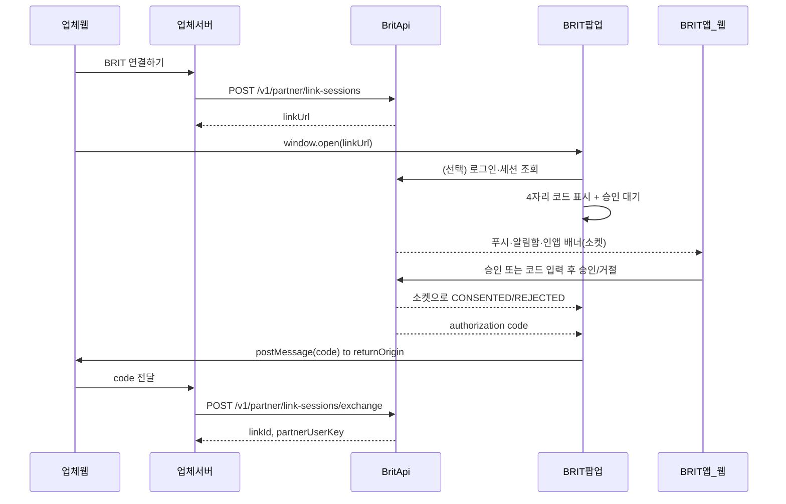

# Merchant Domain (Phase 2 — C2B)

> **문서 상태:** Draft v1.1  
> **대상:** BRIT 사용자·운영자·제휴 업체 개발자·업체 관리자  
> **목적:** 외부 업체와 BRIT MS의 연결, 충전, 환전, 수수료, 정산 및 운영 정책을 정의한다.  
> **설계 기준:** 기존 C2C 거래 도메인과 독립적으로 운영하며, 사용자 Coin/MS 원장은 재사용한다.

**관련 문서**
- 종합 아키텍처: `docs/architecture/trade-platform-summary.md`
- API 상세: `./api-spec.md` §6
- C2C UX: `../process/trade-payment-ux.md`
- C2C 시나리오: `../process/trade-scenarios.md`

---

## 1. 프로젝트 정의

### 1.1 한 줄 정의

외부 제휴 업체 사용자가 BRIT 계정을 연결하고, 보유한 MS를 해당 업체의 전용 포인트로 충전하거나 업체 포인트를 MS로 환전할 수 있도록 제공하는 **B2B2C 자산 전환 시스템**이다.

### 1.2 해결할 문제

| 현재 상황 | 문제 | 시스템 해결 방향 |
|---|---|---|
| 업체마다 별도 포인트 운영 | 서로 다른 포인트를 직접 연동하기 어려움 | BRIT MS를 공통 전환 자산으로 활용 |
| 업체별 독립 회원 계정 | 동일 사용자 식별이 어려움 | 업체 회원과 BRIT 회원 연결 |
| 업체마다 다른 연동 기술 | 개발 및 유지보수 부담 | 공통 SDK 및 API 계약 |
| 서로 다른 자산 원장 | 차감·지급 불일치 위험 | 양측 원장과 전환 상태 관리 |
| 업체별 별도 수수료 | 거래별 수익 추적 어려움 | 수수료 스냅샷 및 정산 원장 |

### 1.3 시스템 책임

**BRIT**
- 업체 Client 인증
- BRIT 사용자 로그인
- 업체 회원 계정 연결
- MS 잔액 및 원장 관리
- 충전·환전 상태 관리
- 외부 지급 결과 검증
- 수수료·정산 관리
- 감사 및 장애 복구

**제휴 업체**
- 업체 회원 인증
- 업체 회원 식별자 제공
- 자체 포인트 잔액 및 원장 관리
- BRIT의 전환 요청에 따른 포인트 지급·차감
- 외부 거래번호 기반 처리 결과 조회
- BRIT Webhook 수신 및 운영 처리

**BRIT SDK**
- 브라우저에서 BRIT 팝업(Embed) 실행 · `postMessage` 결과 수신
- Origin/Source 검증, 취소·오류·닫힘 반환
- **프레임워크 중립**(React 의존 없음). Secret·원장·HTTP는 담지 않음

SDK는 자산 원장을 직접 수정하지 않는다. 배포·최소 API는 §5.0·§6.

---

## 2. C2C와 C2B의 차이

| 항목 | C2C (Phase 1) | C2B (Phase 2) |
|---|---|---|
| 거래 상대 | 다른 사용자 | 제휴 업체 |
| 자산 이동 | 사용자 → 사용자 | 사용자 ↔ 업체 |
| 실제 결제 수단 | 원화 계좌이체 | BRIT MS·업체 포인트 |
| 매칭 | 필요 | 불필요 |
| 승인 | 구매자·판매자 | 사용자 PIN·업체 API |
| 완료 조건 | 입금 확인·MS 이전 | MS 원장·업체 원장 처리 확인 |
| 상태 머신 | Trade | Merchant Exchange |
| UI | Trade Activity | BRIT Embed |
| 실패 복구 | 분쟁 중심 | 외부 API 대사 중심 |
| 수익 | C2C 수수료 정책 | 업체별 전환 수수료 |

C2C의 `Trade`와 C2B의 `MerchantPayment/Exchange`는 동일한 상태 모델을 사용하지 않는다.

단, MS Wallet / Lot / Ledger는 공통 자산 도메인을 사용한다.

---

## 3. 핵심 사용자 및 역할

| 역할 | 목적 | 책임 |
|---|---|---|
| BRIT 사용자 | 업체 포인트 충전·환전 | 로그인, 연결 동의, PIN 승인 |
| BRIT 운영자 | 제휴 업체 운영 | 업체 승인, Client·수수료·정산 관리 |
| 업체 개발자 | BRIT 연동 구축 | SDK 설치, 서버 API·Webhook 구현 |
| 업체 관리자 | 업체 거래 운영 | 거래 조회, 실패 확인, 정산 조회 |
| 업체 서버 | 외부 자산 처리 | 포인트 예약·지급·차감·결과 조회 |

업체 관리자와 BRIT 일반 사용자 계정은 동일 인물일 수 있지만, 업체 관리 권한과 개인 자산은 별도로 관리한다.

---

## 4. Merchant와 Client 구조

### 4.1 Merchant

`Merchant`는 제휴 업체 자체를 나타낸다.

주요 속성 (`partners`):
- `id`
- `code`
- `name`
- `status`
- `contactName` / `contactPhone` / `contactEmail` / `contactTelegram`
- `memo`
- `createdAt`

상태 (확정):

`ACTIVE ↔ SUSPENDED`, `ACTIVE|SUSPENDED → TERMINATED`  
관리자 등록 시 즉시 `ACTIVE`. 사업자등록번호는 MVP에서 수집하지 않는다.

업체 상태와 Client 상태는 독립적으로 관리한다.

### 4.2 Merchant Client

업체가 BRIT 시스템을 호출하기 위한 인증 단위다.

주요 속성:
- `clientId`
- `merchantId`
- `environment`
- `clientType`
- `status`
- `allowedOrigins`
- `scopes`
- `webhookUrl`

업체 하나가 Sandbox와 Production Client를 각각 가질 수 있다.

### 4.3 API Secret

- Secret은 업체 서버에서만 사용한다.
- 브라우저 SDK에 Secret을 전달하지 않는다.
- 서버에는 Secret 원문 대신 안전한 검증 정보만 저장한다.
- 최초 발급 시 원문을 한 번만 제공한다.
- 회전·폐기 이력을 보존한다.

인증 수단에 따라 API Secret 또는 비대칭키 서명 기반 인증을 사용할 수 있다.

### 4.4 업체 등록 프로세스 (1차 — 관리자 수동)

신청은 메신저·메일로 받는다. 시스템 내 셀프 온보딩은 없다.

1. BRIT 운영자가 관리자 페이지에서 업체 생성 → 즉시 `ACTIVE`
2. 업체 담당자가 일반 회원가입 후 승인(`users.ACTIVE`)
3. BRIT 운영자가 `partner_members`로 사용자↔업체 수동 연결
4. 업체 OWNER가 `brit-partner` 「연동」에서 Sandbox Client 발급 · Origin (Admin도 가능)
5. (후속) 연동 테스트 · Production Client · CHARGE/REDEEM

**1차 담당자 규칙** (`partner_members`)

- 연결 대상은 `users.status = ACTIVE`만
- 사용자당 ACTIVE 소속 업체 **1개**. 이미 소속이면 추가 금지, **재배정(변경)**만
- `SUSPENDED` 업체에도 신규 담당자 추가 가능
- `TERMINATED` 업체에는 추가 불가, 기존 담당자 역할 변경·해제만
- 역할: `OWNER` / `MANAGER`
- 최종 사용자 Embed 동의 연결(`user_partner_links`)은 1차 범위 밖

구현 SoT: `brit-api/docs/p0/p0-partner-admin-onboarding.md`  
정책 요약: `docs/roadmap/partner-onboarding-policy.md`

---

## 5. 업체 계정 연결 (Merchant Account Linking)

> **구분:** §4.4의 `partner_members`는 **업체 담당자(운영자)** 연결이다.  
> 이 절의 연결은 **최종 사용자**가 Embed에서 CHARGE/REDEEM 하기 위한 `user_partner_links`다.  
> (팝업 연결·code 교환·Admin 해제는 구현됨. 사용자 앱의 연결 목록·해제는 후속.)

### 5.0 범용 전제 (확정) — 업체는 BRIT가 아니다

제휴 대상은 **다양한 외부 업체**(게임·커머스·플랫폼 등)다. 대부분 이미 **자체 회원 체계·로그인·회원 키**를 갖고 있다.  
`brit-sample-shop`은 BRIT 제품이 아니라, 그런 업체를 흉내 내는 **연동 샘플**이다.

따라서 기본 통합 모델은 “샵에 BRIT 아이디로 로그인”이 아니라 아래다.

```text
업체 회원 (partnerUserKey)  ←연결→  BRIT 사용자 (userId)
```

| 주체 | 책임 |
|---|---|
| 업체 | 자사 회원 인증·세션. `partnerUserKey`는 **업체 회원 식별자** (형식은 업체마다 다름) |
| BRIT | BRIT 계정 로그인·연결 동의·`user_partner_links`·전환 원장 |
| SDK / Embed | 인증 UI는 BRIT 쪽만. 업체 페이지에 BRIT 비밀번호를 받지 않음 |

**하지 않는 것 (기본 경로)**

- `partnerUserKey`를 BRIT `login_id`로 강제하지 않는다. 업체 회원 시스템을 BRIT에 종속시키기 때문이다.
- 업체 웹에 BRIT 아이디/비밀번호 입력란을 두지 않는다 (피싱·신뢰 경계).
- 샘플 샵의 “데모 회원 키 입력”을 BRIT 로그인과 동일시하지 않는다. 그것은 **업체 로그인 흉내**다.

#### 두 모드

| 모드 | 용도 | `partnerUserKey` | SDK 기본 |
|---|---|---|---|
| **연결 (Link)** | 업체가 이미 회원을 갖고 있음. 구글 “계정 연결”과 동일 | 업체 회원 키 | **기본·범용** |
| **BRIT로 로그인 (IdP, 옵션)** | 업체 회원이 없고 BRIT를 IdP로 씀 | 동의 후 `login_id` 등으로 생성 가능 | **후속·별도 제품** |

문서·샘플·Sandbox SDK는 **연결 모드**만 기준으로 한다. IdP 모드는 요구가 생길 때 별도 API·카피로 분리한다.

#### UX 채널

| 방식 | 기본 여부 | 이유 |
|---|---|---|
| **팝업 + `postMessage(code)`** | 기본 | 3rd-party cookie/`SameSite`에 강하고, OAuth·패스키처럼 “인증만 하고 일회용 값만 반환” |
| iframe | 비기본 | 업체 페이지 내 임베드 UX가 필요할 때만. 세션·쿠키 이슈가 커 SDK 기본으로 두지 않음 |

반환 계약은 패스키/OAuth와 같다. 업체는 **일회용 `code` → `exchange` 결과**만 받고, BRIT 비밀번호·세션 쿠키를 받지 않는다.

#### “일치”의 의미 (확정)

연결 모드는 **두 식별자를 붙이는 것**이지, 문자열이 같아야 한다는 뜻이 아니다.

```text
업체 회원키 (partnerUserKey)  ≠  BRIT login_id
         └──────── link ────────┘
```

| 검증 | 필수? | 담당 | 현재 |
|---|---|---|---|
| **세션 바인딩** — `exchange`로 나온 `partnerUserKey`가 **지금 업체에 로그인한 회원**과 같은지 | **필수** | 업체 서버 | 샘플: `LINK_MEMBER_MISMATCH` |
| **POL-LINK-001** — 해당 업체에서 키·BRIT 유저 1:1 | **필수** | BRIT API | 구현됨 |
| **BRIT 클라이언트 승인** — 로그인된 BRIT(앱·PWA·웹)에서 승인/거절 또는 코드 입력 | **필수 (제품 확정)** | BRIT Embed 대기 + BRIT 클라이언트 | §5.2.1 / **MC-P9 P9-1…7** |
| **동의 UI** — 업체명 + 마스킹 회원 키 표시 | 권장 | BRIT 승인 화면 | MC-P9 |
| **거래 PIN** — 연결 이후 CHARGE/REDEEM 건마다 | **CHARGE Intent 경로 구현** | Intent/Embed (B3) | 동기 `charge`는 PIN 없음(임시 Sandbox). REDEEM Embed는 B5 |
| **`login_id` === `partnerUserKey`** | **기본에선 하지 않음** | — | IdP 모드 전용(후속) |

잘못된 해석: “샵에 BRIT 아이디를 쳐서 같게 맞춘다.”  
올바른 해석: “이 code가 **내가 연결을 연 그 업체 회원**에 대한 것인지만 확인한다.”

**신뢰 전제와 한계:** 연결은 “업체 세션을 쓸 수 있는 사람”과 “**BRIT 클라이언트에서 승인한 사람**”을 묶는다.  
샵만 탈취한 공격자는 피해자 BRIT 기기/세션 없이는 연결을 끝낼 수 없다.  
신분증 수준의 본인인증은 아니며, BRIT 계정·기기를 함께 가진 경우에는 여전히 연결 가능하다. 돈 이동은 §5.2.2 거래 PIN으로 막는다.

> **레거시 (MC-P7):** 샵에 4자리 표시 → Embed 입력은 **세션 페어링**이었고 본인 일치 증명이 아니었다. 코드·샘플에 남아 있을 수 있으나 **제품 SoT는 §5.2.1(MC-P9)** 이다.

#### 최소 SDK 표면 (연결 모드 · 확정 방향)

**DX 목표:** 업체 개발자가 **복사할 코드**를 최소화한다. React/Vue/레거시 여부와 무관하게 같은 계약.

업체가 붙일 때 필요한 정보는 아래면 충분하다. Secret은 **업체 서버만**, 브라우저는 `code`만.

**목표 프론트 사용 (개념)**

```text
const result = await openBritLink(() => shopApi.createLinkSession())
if (result.status === 'LINKED') await shopApi.exchangeLinkCode(result.code)
```

**브라우저 (공개, Secret 없음)**

- `openBritLink(getLinkUrl): Promise<{ status, code? }>` — 팝업 열고 `postMessage`로 `code` 수신
- `getLinkUrl`은 **업체가 제공**. SDK는 URL을 어디서 만드는지·Secret이 뭔지 모름
- 코어는 **바닐라 JS/TS** (`window.open` · `postMessage`). React 훅/컴포넌트는 SDK에 넣지 않음 (샘플 UI만 React여도 됨)

**업체 서버 (Secret)**

1. `POST /v1/partner/link-sessions` — body: `{ partnerUserKey, partnerUserLabel?, returnOrigin }` → `{ linkUrl, … }`  
   (`partnerUserKey`는 요청 본문이 아니라 **업체 로그인 세션**에서 꺼내는 것을 권장.  
   **업체 웹에 OTP/코드를 표시하지 않는다.** 표시·승인은 BRIT 팝업·BRIT 클라이언트 책임)
2. `POST /v1/partner/link-sessions/exchange` — body: `{ code }` → `{ linkId, partnerUserKey, linkedAt, … }`
3. 응답 `partnerUserKey`와 현재 세션 회원이 다르면 저장하지 않고 거절

**배포 형태 (같은 API · 소스 하나 → 빌드만 분기)**

| 방식 | 사용 예 | 대상 |
|---|---|---|
| **npm ESM** | `import { openBritLink } from '@brit/sdk'` | Vite/Webpack/Next 등 번들러 |
| **script / IIFE** | `<script src="…/brit-sdk.min.js">` → `Brit.openBritLink(...)` | PHP/JSP·정적 HTML·CDN |
| ESM CDN (후속) | `import` from CDN URL | 모던 정적 페이지 |

- 전역 이름은 짧은 네임스페이스 **`Brit`** (예: `Brit.openBritLink`). `new BritSDK({ clientId })` 초기화는 **쓰지 않음** (브라우저에 Client/Secret을 두지 않음).
- script URL은 **버전 고정**을 권장 (`@0.1.0`). `latest`만 쓰면 깨질 수 있음.
- 연동 가이드는 **npm / script** 두 섹션을 기본으로 두고, 서버 create·exchange는 공통으로 쓴다.

**SDK에 넣지 않는 것**

- 업체 페이지의 BRIT 아이디/비밀번호, iframe 기본 채널, 브라우저 Client Secret, `login_id` 강제 일치
- Client Secret · Partner API 호출 · `partnerUserKey` 저장 · 충전/원장 HTTP
- React/Vue 전용 어댑터 패키지 (필요하면 업체가 한 줄 래핑)
- 연결 승인 UI·거래 PIN UI — 승인(알림·배너·코드 입력)과 PIN은 **BRIT 안**. SDK는 “창 열고 결과 받기”만

**분리·확장**

- 연결: `openBritLink` / 이후 결제: `openBritPay`(가칭)처럼 **얇은 함수를 엔트리별로** 추가할 수 있게 둔다.
- 패키지화(`@brit/sdk`)·설치 가이드는 **MC-P5 / B3s**. 지금은 샘플 `brit-sample-shop/web/src/lib/britSdk.ts`가 브라우저 쪽 최소 구현(원형)이다.

### 5.1 기본 정책

**POL-LINK-001 — 업체별 계정 1:1 연결 (확정)**

- 한 BRIT 사용자는 동일 업체의 회원 계정 하나만 활성 연결할 수 있다.
- 하나의 업체 회원 계정은 하나의 BRIT 사용자에게만 활성 연결할 수 있다.
- 다른 업체와의 연결 개수에는 제한을 두지 않는다.
- 업체 회원 계정 변경은 기존 연결을 수정하지 않고 신규 연결로 처리한다.
- 연결 해제 후에도 기존 전환 및 정산 이력은 보존한다.
- `partnerUserKey`는 업체 측 식별자다. BRIT `login_id`와 같을 필요는 없다 (§5.0).

| 상황 | 처리 | 오류 코드 |
|---|---|---|
| 같은 사용자·같은 회원 키 재요청 | 기존 ACTIVE 연결 반환 (동의 재요구 없음) | — |
| 이미 같은 업체 다른 회원 키와 ACTIVE 연결된 사용자 | **거절.** 기존 연결 해제 후 재시도 안내 | `PARTNER_USER_ALREADY_LINKED` |
| 다른 BRIT 사용자에게 ACTIVE 연결된 회원 키 | 거절 | `PARTNER_USER_LINK_ALREADY_EXISTS` |
| 연결 해제 | 행을 `UNLINKED`로 남김. 같은 키·사용자로 신규 연결 가능. 업체는 `GET /partner/user-links/:key`로 ACTIVE 재확인 | — |
| 해제 시 진행 중인 전환 | **해제 허용.** 시작된 전환은 시작 시점 연결로 끝까지 처리, 이후 신규 전환만 차단 | `PARTNER_USER_LINK_NOT_FOUND` (신규) |

DB: `user_partner_links`에 `status = 'ACTIVE'` 부분 유일 인덱스 2개 — `(partner_id, partner_user_key)`, `(partner_id, user_id)`.  
전환(`partner_exchanges.user_partner_link_id`)은 해제된 연결 행도 계속 참조한다.

BRIT 계정 하나는 여러 업체 계정과 연결할 수 있다.

예시:

| BRIT User | Merchant | Merchant Member | Status |
|---|---|---|---|
| USER-001 | SHOP-A | A-123 | ACTIVE |
| USER-001 | SHOP-B | B-456 | ACTIVE |
| USER-001 | SHOP-C | C-789 | ACTIVE |

업체별 연결은 독립적으로 생성·해제한다.

### 5.2 최초 연결 프로세스 (구현: OAuth authorization code 방식)

구글 서드파티 **계정 연결**과 같은 구조다 (§5.0 연결 모드).  
전제: 사용자는 이미 **업체 사이트에 업체 회원으로 로그인**한 상태다.  
연결은 **사용자 동의 시점**에 생기고, 업체 서버가 Secret으로 code를 교환해 확정을 확인한다.

**제품 정책 (확정):**

| 단계 | 수단 | 상태 |
|---|---|---|
| 최초 연결 | **BRIT 클라이언트 승인** (§5.2.1) | 확정 · **미구현** (MC-P9). 레거시 MC-P7(샵 OTP)은 폐기 예정 |
| 연결 이후 충전·환전 | **거래 PIN** 건마다 (§5.2.2, B3) | CHARGE Intent+Embed PIN 구현. 동기 `charge`/`redeem`은 PIN 없음(Sandbox) |



1. 사용자가 **업체** 홈페이지에 **업체 회원**으로 로그인한다. (BRIT 아이디 입력이 아님)
2. 「BRIT 연결하기」(또는 첫 충전)를 누른다.
3. 업체 서버가 **현재 세션의** `partnerUserKey`·표시명·`returnOrigin`으로 연결 세션을 만든다. `returnOrigin`은 해당 Client에 등록된 Origin만 허용한다.
4. SDK가 `brit-front` `/embed.html#session=…` **팝업**을 연다. 토큰은 URL fragment로만 전달하고 팝업이 즉시 주소창에서 지운다. **업체 웹에는 코드를 표시하지 않는다.**
5. 팝업은 (필요 시) BRIT 로그인을 받은 뒤 **4자리 연결 코드를 크게 보여 주고 승인 대기**한다. 실시간 상태는 **소켓**으로 받는다(폴링 비권장).
6. 사용자는 **이미 로그인된 BRIT 클라이언트**(폰 앱·설치 PWA·데스크탑 브라우저 탭)에서 승인한다 (§5.2.1). 업체 페이지는 BRIT 비밀번호를 받지 않는다.
7. BRIT이 POL-LINK-001 기준으로 상태를 판정한다 — `NEW` / `ALREADY_LINKED_SAME` / `CONFLICT_OTHER_KEY` / `CONFLICT_KEY_TAKEN`. 충돌이면 연결하지 않고 안내한다. (`ALREADY_LINKED_SAME`은 재승인 생략 가능)
8. BRIT 클라이언트에서 승인되면 `user_partner_links`를 만들고, 팝업이 1회용 authorization `code`를 `returnOrigin`으로 `postMessage`한다.
9. 업체 서버가 code를 교환해 `partnerUserKey`가 **현재 업체 세션 회원**과 같은지 확인한 뒤 연결 상태를 저장한다.
10. 이후 충전·환전은 **건마다 BRIT PIN**으로 승인한다 (§5.2.2, B3). Sandbox 동기 API만 있는 동안은 PIN 없이 동작할 수 있으나 운영 경로로 쓰지 않는다.

세션 토큰·authorization code·연결 코드는 DB에 SHA-256 해시만 저장한다(`partner_link_sessions`).  
상태: `PENDING` → (BRIT 클라이언트 승인) → `CONSENTED` → `EXCHANGED`, 또는 `REJECTED` / `EXPIRED`.

#### 5.2.1 BRIT 클라이언트 승인 — 앱·웹 승인 (확정 · MC-P9)

**목적:** 연결 확정을 **BRIT에 로그인된 클라이언트**(앱·PWA·데스크탑 웹)에서만 하게 한다.  
업체는 `openBritLink`만 쓰고, OTP/승인 UI를 만들지 않는다. (넥슨 플러그형: PC/팝업에 코드·대기, 승인 앱·웹에서 처리)

**약속 문구:** “BRIT 기기·세션에서 승인한 연결”이다. 신분증 본인확인·KYC가 아니다.

**UX 원칙**

- 이탈 일부는 감수한다. 대신 BRIT 쪽 진입·승인 UI를 단순하게 유지한다.
- **푸시는 가속 장치**다. 실패해도 같은 요청이 **알림함**과 **열린 BRIT 화면의 배너/시트**에 남는다.
- **데스크탑도 1급 클라이언트**다. 폰 전용이 아니라, 팝업 옆 BRIT 탭/PWA에서도 승인·코드 입력이 가능해야 한다.
- 실시간 동기화는 **소켓**을 기본으로 한다(팝업 대기, 인앱 배너/알림함 갱신). 폴링은 폴백(P9-2 임시 허용).

##### 보안 계약 (P9-0 · 구현 필수)

| 규칙 | 내용 |
|---|---|
| **팝업 claim 필수** | Embed에서 BRIT 로그인 후 `claimedUserId`를 세션에 고정한다. 다른 사용자가 이미 claim한 세션은 거절 |
| **코드 표시 시점** | claim **이후**에만 팝업에 4자리 표시. 업체 create 응답의 평문 코드는 쓰지 않음(레거시 제거) |
| **코드 조회 범위** | `by-code`는 **전역 PENDING 검색 금지**. `claimedUserId === 현재 userId`인 세션만 해시 대조 |
| **승인 주체** | approve/reject는 claim된 사용자와 동일 계정만. 알림·배너도 그 userId에게만 |
| **4자리 브루트포스** | 위 claim 스코프 + 세션당 5회 + TTL 3분. claim 없는 코드는 승인 경로에 진입 불가 |
| **팝업 조기 종료** | 팝업을 닫으면 샵이 `postMessage(code)`를 못 받을 수 있다. 카피: “승인될 때까지 이 창을 닫지 마세요”. 후속: 샵 측 연결 상태 조회(별도) |

##### 제품 표

| 항목 | 정책 |
|---|---|
| 사용 시점 | **최초 연결(NEW)만.** `ALREADY_LINKED_SAME`은 팝업에서 재승인·코드 생략 가능 |
| 팝업 역할 | ① 로그인(claim) ② 코드 **표시** ③ “BRIT에서 승인해 주세요” + 대기. **최종 승인 CTA 없음** |
| 연결 코드 | 숫자 **4자리**. 팝업만 표시. 업체 웹 표시 **금지** |
| 승인 경로 (우선순위) | ① 열린 BRIT **배너/시트** → ② **알림함** → ③ OS/PWA **푸시**(선택) → ④ **코드 수동 입력** |
| 승인 화면 | 업체명·마스킹 회원 키 + **승인 / 거절** |
| 저장 | `pairing_code_hash` (+ 팝업 표시용 평문은 claim 후 Embed에만, 종료 시 삭제). `claimed_user_id` / `claimed_at` |
| 만료 | 세션 TTL **3분**. `EXPIRED` 시 팝업·BRIT 문구 통일. Embed에 줄어드는 타이머 막대 |
| 시도 | 코드 입력 최대 **5회** / 세션 |
| create 응답 | `{ linkUrl, expiresAt, … }`. 업체용 `pairingCode` **없음** |
| 소켓 (P9-4) | `link_session.pending` / `approved` / `rejected` / `expired` |
| 알림 (P9-5) | **claim 이후**에만 해당 userId 알림함 생성 |

##### API 스케치 (P9-1+)

```text
# Embed (JWT + sessionToken)
POST /v1/embed/link-sessions/:token/claim     # claimedUserId 고정 · 코드 평문 1회/조회용
GET  /v1/embed/link-sessions/:token           # 상태·코드(claim 후)·linkState
GET  /v1/embed/link-sessions/:token/events    # SSE link_session (승인·거절·만료)
GET  /v1/embed/link-sessions/:token/wait      # 상태 1회·SSE 폴백

# BRIT 클라이언트 (JWT)
POST /v1/me/partner-link-approvals/preview    # { pairingCode } | { sessionId }
POST /v1/me/partner-link-approvals/approve    # { pairingCode } | { sessionId }
POST /v1/me/partner-link-approvals/reject
```

##### 구현 블록

| ID | 범위 | Done |
|---|---|---|
| **P9-0** | 본 절 계약 | 문서 합의 (본 절) |
| **P9-1** | claim·승인 API | curl로 코드 승인 → exchange 성공 |
| **P9-2** | Embed 코드+대기 UI | 팝업 표시·대기(임시 폴링 가능) |
| **P9-3** | BRIT 코드 입력 화면 | S1: PC 샵 + PC BRIT 탭 승인 |
| **P9-4** | 소켓(SSE) | ✅ Embed `/events` · 폴링은 폴백만 |
| **P9-5** | 알림함 | ✅ claim 후 `PARTNER_LINK_APPROVAL_REQUESTED` |
| **P9-6** | 인앱 배너 | ✅ 기존 글로벌 배너 + deepLink |
| **P9-7** | 레거시 제거 | ✅ 샵 OTP·create 평문·Embed consent pairing 삭제 |
| **P9-8** | 웹 푸시 | 선택 |

##### 1차 수용 시나리오 (S1)

1. 샵 회원 로그인 → 연결하기 → 팝업 claim(BRIT 로그인) → 코드 표시  
2. 다른 BRIT 탭에서 코드 입력(또는 알림/배너) → 승인  
3. 팝업이 code를 샵에 전달 → exchange → 연결됨  

S1 통과 전 푸시·소켓 확장 금지. 상세 시나리오 S2~S12는 리뷰 메모(claim·브루트포스·팝업 닫힘)를 따른다.

**승인(코드·알림)이 증명하는 것:** claim된 BRIT 계정의 클라이언트에서 이 link-session을 확정했다.  
**증명하지 않는 것:** 신분증 본인인증. 샵+공격자 BRIT를 모두 가진 경우(S8)는 막지 않음 → 거래 PIN·연결 목록 해제로 완화.

**레거시 MC-P7:** 샵 표시 → Embed 입력. **P9-7에서 제거 완료.** Embed consent는 ALREADY_LINKED_SAME만 유지.

**함께 둘 것:** 연결 목록·해제(B2), 거래 PIN(§5.2.2), (선택) 샵 재인증.

백로그: **MC-P9** = P9-1…P9-8.

#### 5.2.2 거래 PIN — 연결 이후 건마다 (확정 · CHARGE 구현)

**목적:** 연결만으로 MS·포인트가 움직이지 않게 한다. “연결은 한 번, 돈 이동은 매번 승인.”

| 항목 | 정책 |
|---|---|
| 사용 시점 | ACTIVE 연결 이후 **CHARGE / REDEEM 매 건** |
| UI | Intent + Embed `/embed-pay.html#intent=` 에서 PIN (B3) |
| Sandbox 동기 `POST /partner/exchanges/charge\|redeem` | 개발·연동 검증용. **PIN 없음 → 운영 공개 경로로 쓰지 않음** |

백로그: **B3** CHARGE Intent+PIN 완료(샘플 포함). REDEEM Embed는 B5. `@brit/sdk`는 MC-P5.

### 5.3 재방문

기존 연결이 ACTIVE이고 연결 당사자가 동일하면 연결 동의를 재요구하지 않는다.

단, 거래 승인은 별도로 수행한다.

### 5.4 연결 해제

사용자가 연결을 해제하면 이후 신규 전환 요청을 제한한다.

기존 완료 거래, 정산 근거와 감사 이력은 유지한다.

진행 중인 전환이 있을 경우 연결 해제가 해당 거래의 복구 책임을 없애서는 안 된다.

### 5.5 연결 예외

- BRIT 로그인 실패
- 사용자 연결 동의 거부
- 업체 회원 식별자 변경
- 이미 다른 BRIT 회원에 연결된 업체 계정
- 업체 Client 정지
- 연결 세션 만료
- 사용자 계정 정지
- 연결 해제 후 재연결

동일 업체 다중 회원 계정 연결은 POL-LINK-001에 따라 허용하지 않는다.

---

## 6. SDK 및 Embed 구조

> **계약의 기준은 §5.0.** 이 절은 책임 경계·배포·Embed 과업을 정리한다.  
> `@brit/sdk` 패키지는 **아직 없음**(MC-P5). 현재 원형은 `brit-sample-shop/web/src/lib/britSdk.ts`.

### 6.1 SDK의 책임

SDK는 업체 브라우저에서 BRIT Embed를 **쉽게 띄우고 결과만 받기** 위한 **얇은** Web 라이브러리다.

**하는 일**
- 사용자 클릭 직후 팝업 오픈(차단 완화) → 업체가 준 `linkUrl`/`payUrl`로 이동
- `postMessage` Origin·Source 검증
- `LINKED`+`code` / `REJECTED` / `ERROR` / `CLOSED` 반환
- (후속) 모바일에서 팝업 불가 시 리다이렉트 채널

**하지 않는 일**
- Client 초기화·브라우저 `clientId`/`Secret`
- Partner API HTTP, 원장, `partnerUserKey` 저장
- React/Vue 컴포넌트 강제
- iframe을 기본 채널로 제공

자산 원장은 업체 서버 + BRIT API가 수정한다. SDK는 원장을 건드리지 않는다.

### 6.2 사용 예시 (연결 · npm)

```typescript
import { openBritLink } from "@brit/sdk";

button.addEventListener("click", async () => {
  const result = await openBritLink(async () => {
    const session = await shopApi.createBritLinkSession(); // 업체 서버
    return session.linkUrl;
  });
  if (result.status === "LINKED") {
    await shopApi.exchangeBritLinkCode(result.code); // 업체 서버 → BRIT exchange
  }
});
```

### 6.2.1 사용 예시 (연결 · script 태그)

```html
<script src="https://cdn.example.com/brit-sdk@0.1.0/brit-sdk.min.js"></script>
<script>
  document.getElementById("link").onclick = async () => {
    const result = await Brit.openBritLink(async () => {
      const session = await shopApi.createBritLinkSession();
      return session.linkUrl;
    });
    if (result.status === "LINKED") {
      await shopApi.exchangeBritLinkCode(result.code);
    }
  };
</script>
```

npm·script는 **동일 API**. 업체 서버가 Secret으로 link-session을 만들고, SDK는 팝업만 연다.  
충전(Intent·PIN)도 같은 패턴이다: 서버가 세션/Intent URL 발급 → `openBritPay`(가칭) → 결과 코드/상태만 수신 (B3).

### 6.3 팝업 · iframe · 리다이렉트

| 방식 | 기본? | 비고 |
|---|---|---|
| **데스크톱/모바일 팝업 + `postMessage`** | **기본** | §5.0. 3rd-party cookie에 강함 |
| 모바일 풀페이지 리다이렉트 | 후속 | 팝업 차단·OS WebView 대비 |
| iframe | **비기본** | 임베드 UX가 필요할 때만. 세션·쿠키 이슈가 커서 SDK 기본에 두지 않음 |

iframe의 인증 세션이 항상 유지된다고 가정하지 않는다.

### 6.4 Embed 내 사용자 과업

팝업(또는 후속 리다이렉트) 안에서 사용자가 하는 일:

1. BRIT 로그인(팝업 또는 BRIT 클라이언트)
2. (최초 연결) 팝업은 코드·대기, **BRIT 클라이언트에서 승인/거절** (§5.2.1)
3. (충전·환전) 요청 업체·금액·수수료·차감액 확인
4. 사용 가능한 MS 잔액 확인
5. 거래 PIN 승인 (§5.2.2)
6. 처리 진행·완료·실패 안내

업체가 사용자 BRIT 잔액을 직접 조회하는 API는 MVP에서 제공하지 않는다.

---

## 7. Merchant Payment Intent

> **상태:** B3 CHARGE Intent + Embed PIN 구현. `@brit/sdk` 패키지는 MC-P5(샘플 `openBritPay` 원형 있음).  
> Sandbox 동기 전환 §17 `POST /v1/partner/exchanges/charge|redeem`은 PIN 없이 유지(검증용).

### 7.1 정의

`MerchantPaymentIntent`는 업체가 사용자에게 BRIT MS 충전을 요청하기 위해 생성하는 **일회성 거래 의도**다.

Intent는 실제 자산 이전 결과와 구분한다.

### 7.2 생성 주체

업체 백엔드.

### 7.3 필수 데이터

- `intentId`
- `merchantId`
- `clientId`
- `externalOrderId`
- `merchantMemberKey`
- `chargeAmountMs`
- `feeAmountMs`
- `totalDebitMs`
- `status`
- `expiresAt`
- `createdAt`

추가 후보:
- `merchantAssetId`
- `merchantCreditAmount`
- `exchangeRateSnapshot`
- `commissionPolicyId`
- `returnUrl`
- `metadata`

업체 회원 식별자는 업체 서버에서 인증한 값으로 고정한다.

### 7.4 Intent 생성 API

```http
POST /v1/merchant/payments/intents
Authorization: Bearer {server_access_token}
Idempotency-Key: {unique_request_key}
```

Request:

```json
{
  "merchantCode": "GAME_SHOP_A",
  "externalOrderId": "shop-order-991",
  "merchantMemberKey": "A-123",
  "chargeAmountMs": 50000,
  "returnUrl": "https://shop.example/charge/callback",
  "metadata": {
    "productName": "게임 포인트 충전"
  }
}
```

Response:

```json
{
  "intentId": "mpi_xxx",
  "widgetUrl": "https://brit.app/embed/pay?intent=mpi_xxx",
  "chargeAmountMs": 50000,
  "feeAmountMs": 0,
  "totalDebitMs": 50000,
  "status": "CREATED",
  "expiresAt": "2026-11-03T12:00:00Z",
  "expiresInSec": 600
}
```

위 금액과 수수료는 정책 미확정 상태의 예시다.

BRIT 서버는 인증된 Client에서 업체를 결정해야 하며, 요청 본문의 `merchantCode`는 인증 주체와 일치하는지 검증한다.

### 7.5 Intent 멱등성

- 같은 업체의 같은 `externalOrderId`는 동일 거래로 식별한다.
- 같은 주문번호에 다른 금액이 전달되면 거절한다.
- 이미 완료된 Intent는 다시 처리하지 않는다.
- HTTP 재시도는 기존 결과를 반환한다.

---

## 8. Merchant Payment 및 충전 프로세스

### 8.1 CHARGE 정의

사용자의 BRIT MS를 차감하고, 해당 업체가 관리하는 포인트를 지급한다.

**전제:** 1 MS = 1포인트 상당으로 가정한다.

### 8.2 정상 흐름

| 단계 | 주체 | 처리 | 데이터 |
|---|---|---|---|
| 1 | 사용자 | 충전 요청 | 외부 주문 |
| 2 | 업체 서버 | Intent 생성 | MerchantPaymentIntent |
| 3 | BRIT | 로그인·계정 연결 확인 | UserMerchantLink |
| 4 | 사용자 | PIN 승인 | Authorization |
| 5 | BRIT | MS 잠금 | Wallet / Ledger |
| 6 | BRIT | 업체 포인트 지급 요청 | MerchantPayment |
| 7 | 업체 | 포인트 지급 및 결과 반환 | 업체 포인트 원장 |
| 8 | BRIT | MS 차감 확정 | MS Ledger |
| 9 | BRIT | 완료 및 수수료 기록 | Payment / Fee |
| 10 | BRIT | 완료 Webhook 전송 | Webhook Delivery |

### 8.3 자산 책임

**BRIT 원장**
- 사용자 MS 차감
- 업체 MS 증감
- 수수료 수익
- 전환 거래번호

**업체 원장**
- 업체 회원의 포인트 증감
- 전환 처리 결과
- 중복 처리 방지
- 업체 내 포인트 사용 내역

BRIT의 `merchantCreditMs`와 실제 업체 포인트 지급은 동일한 데이터가 아니다.

### 8.4 실패 복구

업체 포인트 지급 API가 타임아웃되었다고 해서 곧바로 MS를 반환하지 않는다.

결과 확인 프로세스를 사용한다.

- 업체 처리 성공 확인 → MS 차감 확정
- 업체 미처리 확정 → MS 잠금 해제
- 처리 여부 불명 → `RECONCILIATION_REQUIRED`
- 장기 불일치 → 운영자 조사

---

## 9. 상태 모델

### 9.1 Intent 상태

권장 상태:

```text
CREATED
  ├─ USER_AUTHORIZED
  ├─ CANCELLED
  └─ EXPIRED

USER_AUTHORIZED
  └─ PAYMENT_PROCESSING
```

사용자가 PIN을 승인했다고 해서 실제 거래가 완료되었다는 뜻은 아니다.

### 9.2 Payment 상태

```text
REQUESTED
  → ASSET_LOCKED
  → MERCHANT_PROCESSING
      ├─ COMPLETED
      ├─ FAILED_CONFIRMED
      └─ RECONCILIATION_REQUIRED
            ├─ COMPLETED
            └─ FAILED_CONFIRMED
```

### 9.3 상태 정책

- Intent는 만료 후 새로 승인할 수 없다.
- 이미 자산 처리에 진입한 거래는 Intent 만료만으로 취소하지 않는다.
- 사용자 PIN 승인 전에는 취소할 수 있다.
- 외부 지급 진행 중에는 임의 취소를 제한한다.
- 완료된 Payment는 직접 수정하지 않는다.
- 완료 후 취소는 별도 환불·보정 거래를 생성한다.
- 상태 변경은 이벤트로 기록한다.

Intent와 Payment는 상태 소유 주체를 분리한다.

---

## 10. Webhook

### 10.1 목적

Webhook은 BRIT이 업체 서버에 거래의 확정 결과 또는 주요 상태 변경을 전달하는 서버 간 통지 수단이다.

### 10.2 완료 이벤트 예시

```json
{
  "eventId": "evt_001",
  "event": "MERCHANT_PAYMENT_COMPLETED",
  "intentId": "mpi_xxx",
  "paymentId": "mp_xxx",
  "externalOrderId": "shop-order-991",
  "chargeAmountMs": 50000,
  "completedAt": "2026-11-03T12:00:00Z"
}
```

업체는 BRIT 사용자 실명·전화번호를 받지 않는다.

회원 식별이 필요한 경우 업체가 생성한 `externalOrderId`와 자신의 내부 주문 기록을 사용한다.

### 10.3 보안

- HMAC-SHA256 서명
- Timestamp 검증
- 이벤트 식별자 기반 중복 방지
- HTTPS 사용
- 서명 키 회전 지원

### 10.4 전송 정책

- Webhook 실패 시 재시도한다.
- 같은 `eventId`를 중복 수신해도 안전해야 한다.
- 업체는 별도 거래 결과 조회 API를 사용할 수 있다.
- Webhook 전송 실패가 이미 완료된 자산 거래를 취소하지 않는다.

---

## 11. iframe 메시지 통신

### 11.1 완료 메시지

```javascript
window.parent.postMessage(
  {
    type: "BRIT_PAYMENT_SUCCESS",
    intentId: "mpi_xxx",
    paymentId: "mp_xxx"
  },
  "https://shop.example"
);
```

### 11.2 메시지 종류

| 메시지 | 의미 |
|---|---|
| `BRIT_WIDGET_READY` | Embed 준비 완료 |
| `BRIT_PAYMENT_SUCCESS` | BRIT 기준 거래 완료 |
| `BRIT_PAYMENT_CANCELLED` | 사용자 취소 |
| `BRIT_PAYMENT_PENDING` | 처리 결과 확인 중 |
| `BRIT_PAYMENT_ERROR` | 오류 발생 |

### 11.3 원칙

- BRIT은 사전 등록된 업체 Origin으로만 메시지를 전송한다.
- SDK는 메시지 Origin과 Source를 검증한다.
- iframe 메시지는 UI 갱신용으로 사용한다.
- 실제 거래 완료 여부는 업체 서버에서 BRIT API를 통해 확인한다.

---

## 12. REDEEM — 업체 포인트 환전

> **구현 상태:** Sandbox **서버 동기** `POST /v1/partner/exchanges/redeem` 는 구현됨 (§17).  
> 아래 흐름·Embed 승인 UI·비동기 Intent 환전은 **제품/후속** 설계다.

### 12.1 정의

업체 포인트를 차감하고 BRIT MS로 전환한다.

### 12.2 정상 흐름

1. 사용자가 업체에서 환전을 요청한다.
2. 업체가 환전 세션을 생성한다.
3. BRIT에서 계정 연결을 확인한다.
4. 사용자가 환전을 승인한다.
5. 업체가 포인트 사용 가능 여부를 확인한다.
6. 업체가 포인트를 예약·차감한다.
7. BRIT이 MS 지급을 확정한다.
8. 전환 결과와 수수료를 기록한다.

### 12.3 기존 BRIT 원장 연결

환전으로 지급된 MS는 `PARTNER_REDEEM` 출처 Lot으로 관리하는 방안을 유지한다.

기존 정책에 따라 판매 가능 자산으로 취급할 수 있다.

단, 업체의 지급 의무와 Coin 공급·발행 근거를 별도로 검증해야 한다.

### 12.4 업체 마이너스 한도 (확정·구현됨)

| 항목 | 정책 |
|---|---|
| 단위 | 업체별 `partner_coin_wallets.credit_limit` (MS 최소단위, 0 이상 정수) |
| 기본값 | `0` — 한도를 주지 않은 업체는 잔액이 음수가 되는 REDEEM 불가 |
| 판정 | REDEEM 후 `available_balance >= -credit_limit` 이면 허용 |
| 초과 시 | 즉시 거절 `409 PARTNER_CREDIT_LIMIT_EXCEEDED`. 트랜잭션 전체 롤백(사용자 지급·수수료 기록 없음) |
| CHARGE | 업체 잔액을 늘리기만 하므로 한도 검사 없음 |
| 한도 하향 | 현재 음수 잔액보다 작게 내려도 허용. 이후 REDEEM만 막힘 |
| 변경 | Admin만 (`PATCH /v1/admin/partners/:id/wallet/credit-limit`), 감사 로그 `UPDATE_PARTNER_CREDIT_LIMIT` |

### 12.5 충전·환전 판매 가능 여부 비대칭 (미결정 · 보류 MC-P3)

> **상태:** 상의 후 결정. 코드 변경 없음. 백로그 `MC-P3`.

현재 동작:

- CHARGE: 사용자 **판매 불가(nonSellable)** MS만 차감한다 (`debitNonSellable`).
- REDEEM: 사용자에게 **판매 가능(sellable)** MS로 지급한다 (`PARTNER_REDEEM` Lot).

문제:

- 판매 불가 MS로 충전한 뒤 같은 금액을 환전하면 판매 가능 MS로 바뀐다. P2P 판매 제한을 우회하는 경로가 된다.
- 판매 가능 MS만 가진 사용자는 잔액이 있어도 CHARGE가 `COIN_BALANCE_INSUFFICIENT`로 실패한다.

대안 (택1, 정책 결정 필요):

1. CHARGE는 판매 불가 → 판매 가능 순서로 차감하고, REDEEM은 판매 불가로 지급한다. 우회 경로를 막지만 §12.3·ERD의 `PARTNER_REDEEM = sellable` 정책을 바꿔야 한다.
2. CHARGE 차감 순서만 바꾸고 REDEEM은 판매 가능 지급을 유지한다. 충전 실패는 해결되지만 우회 경로는 남는다.
3. CHARGE 때 쓴 판매 불가 금액을 사용자·업체별로 기록하고, REDEEM 때 그만큼은 판매 불가로 되돌려 지급한다. 정확하지만 별도 원장이 필요하다.

---

## 13. 수수료 및 정산

### 13.1 수수료 정책

예정 속성:

```text
merchantId
exchangeType
commissionBps
fixedFeeMs
minFeeMs
maxFeeMs
feePayer
settlementCycle
effectiveFrom
effectiveTo
```

`commissionBps = 70`이면 수수료율은 0.7%다.

### 13.2 거래별 수수료 스냅샷

수수료는 Intent 생성 또는 거래 승인 시점에 계산·고정한다.

확정 시점을 결정해야 하며, 현재 추천은 **Intent 생성 시 견적을 고정하고 거래 완료 시 수수료 발생을 확정**하는 방식이다.

완료된 거래에는 이후 수수료 정책 변경을 소급 적용하지 않는다.

### 13.3 정산 프로세스

```text
완료된 Merchant Payment
  → 거래별 수수료 확정
  → 정산 대상 등록
  → 정산 기간 종료
  → 정산서 생성
  → BRIT 운영자 확인
  → 업체 청구
  → 입금 확인
  → 정산 완료
```

### 13.4 파트너 관리자 제공 정보

- 기간별 거래 건수
- 충전·환전 총액
- 거래별 수수료
- 확정 정산금
- 미납 금액
- 입금 완료 금액
- 정산 상태
- 실패·확인 필요 거래

### 13.5 미결정

- 수수료 부담 주체
- 수수료율
- 최소·최대 수수료
- 정산 방식
- 환불 시 수수료 반환
- 연체 처리
- ~~음수 업체 잔액 허용 범위~~ → **확정:** 업체별 `credit_limit`(기본 0), 초과 시 즉시 거절 (§12.4)

---

## 14. 예외 처리

| 상황 | 시스템 처리 | 사용자 안내 |
|---|---|---|
| Intent 만료 | 승인 차단 | 요청 시간이 만료됨 |
| 로그인 실패 | 재인증 | 다시 로그인 필요 |
| 연결 거절 | 연결 종료 | 연결이 취소됨 |
| 잔액 부족 | 차감 중단 | 충전 가능한 MS 부족 |
| PIN 오류 | 재시도 제한 | PIN 확인 필요 |
| 업체 지급 실패 | 잠금 해제 | 충전이 완료되지 않음 |
| 업체 API 타임아웃 | 결과 조회·대사 | 충전 결과 확인 중 |
| Webhook 미전달 | 재전송 | BRIT 완료 상태 유지 |
| 중복 Intent | 기존 결과 반환 또는 충돌 거절 | 중복 충전 방지 |
| 이미 완료된 거래 취소 | 환불 업무로 분리 | 취소 절차 안내 |
| 업체 Client 중지 | 신규 요청 거부 | 일시적으로 이용 불가 |

모든 예외에서 현재 거래의 상태, 자산 잠금 여부, 복구 책임자를 식별할 수 있어야 한다.

---

## 15. 운영자와 업체 관리자 권한

| 기능 | BRIT 운영자 | 업체 관리자 |
|---|---|---|
| 업체 등록·중지 | 가능 | 불가 |
| Client 발급 | 가능 | Sandbox만 가능(OWNER) · Production은 요청 |
| Client 비밀키 재발급 | 가능 | Sandbox만 가능(OWNER) |
| Client Secret 폐기 | 가능 | 정책에 따른 요청 |
| 업체 담당자 관리 | 가능 | 소속 업체 범위 |
| 수수료 정책 변경 | 가능 | 불가 |
| 전환 거래 조회 | 전체 | 소속 업체 |
| 정산 조회 | 전체 | 소속 업체 |
| 강제 보정 | 별도 권한·승인 | 불가 |
| 감사 로그 | 권한 범위 | 제한된 업무 이력 |

업체 담당자는 다른 업체의 거래 및 정산 정보를 조회할 수 없다.

관리자 강제 보정에는 변경 사유, 변경 전후 값, 관련 거래번호, 처리자를 기록한다.

---

## 16. ERD 구성 방향

### 16.1 기존 ERD v4 재사용

| Merchant 개념 | 기존 ERD v4 |
|---|---|
| Merchant | `partners` |
| Merchant Manager | `partner_members` |
| Merchant Client | `partner_clients` |
| Client Secret | `partner_client_secrets` |
| Client Scope | `partner_client_scopes` |
| Allowed Origin | `partner_client_origins` |
| Account Link Session | `partner_link_sessions` |
| User Merchant Link | `user_partner_links` |
| Merchant Asset | `partner_assets` |
| Merchant Exchange | `partner_exchanges` |
| Exchange Events | `partner_exchange_events` |
| External Attempts | `partner_exchange_attempts` |
| Commission Policy | `partner_fee_policies` |
| Commission Accrual | `partner_fee_accruals` |
| Settlement | `partner_settlements` |
| Settlement Items | `partner_settlement_items` |
| Settlement Payments | `partner_settlement_payments` |
| Merchant Wallet | `partner_coin_wallets` |
| Merchant Ledger | `partner_coin_ledger_entries` |

### 16.2 신규 개념 검토

- `MerchantPaymentIntent`: 업체의 일회성 충전 요청
- `MerchantPayment`: 자산 처리 결과
- `MerchantWebhookDelivery`: Webhook 전송 이력
- `MerchantReconciliation`: 외부 원장 대사 작업

`MerchantPayment`와 기존 `partner_exchanges`를 각각 독립된 루트로 만들지 여부는 미확정이다.

**추천:** 단순 충전·환전이라면 `partner_exchanges`를 실제 거래 루트로 재사용하고, Intent만 독립적으로 추가한다. 중복된 원장·상태 관리 테이블은 만들지 않는다.

---

## 17. API 구성 방향

> **확정:** 관리자·DB·코드 네임스페이스는 `partner`로 통일한다.  
> 구현 SoT: `brit-api/docs/p0/p0-partner-admin-onboarding.md`

### BRIT 운영자 (구현됨)

```text
GET|POST   /v1/admin/partners
GET|PATCH  /v1/admin/partners/:partnerId
POST       /v1/admin/partners/:partnerId/suspend|resume|terminate
GET|POST   /v1/admin/partners/:partnerId/members
POST       /v1/admin/partners/:partnerId/members/reassign
PATCH|POST /v1/admin/partners/:partnerId/members/:memberId(|/remove)
GET|POST   /v1/admin/partners/:partnerId/clients
GET|PATCH  /v1/admin/partners/:partnerId/clients/:partnerClientId
POST       /v1/admin/partners/:partnerId/clients/:partnerClientId/rotate-secret|revoke
GET|POST   /v1/admin/partners/:partnerId/fee-policies
POST       /v1/admin/partners/:partnerId/fee-policies/:policyId/deactivate
```

### 업체 포털 (담당자 JWT · 구현됨)

```text
GET    /v1/partner/me
GET    /v1/partner/dashboard   # setup: assetReady·feePolicyReady·잔액·creditLimit·remainingCredit (MC-P2)
GET    /v1/partner/fee-policies
GET    /v1/partner/fee-accruals
GET    /v1/partner/exchanges
```

Admin 동일 요약: `GET /v1/admin/partners/:id/dashboard` (같은 `setup` 필드).

앱: `brit-partner` (일반 `/auth/login` + `partner_members` ACTIVE).

### 업체 서버 — CHARGE/REDEEM (Sandbox 동기 · 구현됨)

인증: `X-Partner-Client-Id` + `X-Partner-Api-Secret` (SERVER Client, scope 필요)

```text
POST   /v1/partner/exchanges/charge   # EXCHANGE_CHARGE
POST   /v1/partner/exchanges/redeem   # EXCHANGE_REDEEM
```

Admin 준비: `POST /v1/admin/partners/:id/assets`, `POST .../user-links`  
Admin 연결 해제: `POST /v1/admin/partners/:id/user-links/:linkId/unlink` (POL-LINK-001)  
Admin 업체 잔액·한도: `GET /v1/admin/partners/:id/wallet`, `PATCH .../wallet/credit-limit` (§12.4)  
전제: ACTIVE 링크·ACTIVE 사용자(MC-P1)·자산·수수료 정책.  
멱등: `idempotencyKey` (또는 `Idempotency-Key` 헤더) — 유형·금액·`userId`/`linkId` 불일치 시 conflict.

Intent + Embed PIN (B3 · CHARGE):

```text
POST   /v1/partner/payments/intents          # EXCHANGE_CHARGE · payUrl 발급
GET    /v1/partner/payments/intents/:id
GET    /v1/embed/intents/:id                 # JWT · 금액·잔액·승인 가능 여부
POST   /v1/embed/intents/:id/authorize       # { pin } → 동기 CHARGE
POST   /v1/embed/intents/:id/cancel
GET    /v1/embed/intents/:id/status
# 팝업: BRIT_EMBED_BASE_URL + /embed-pay.html#intent={id}
```

업체 회원 연결 상태 조회 (샵 UI SoT · `USER_LINK`):

```text
GET    /v1/partner/user-links/:partnerUserKey
# → { status: ACTIVE|NONE, linkId, partnerUserKey, linkedAt }
# 로컬 캐시만 믿지 말고 표시·충전 전에 재확인 (샘플 샵 syncBritLink)
```

### 사용자 계정 연결 (user_partner_links · §5.2)

업체 서버 (`X-Partner-Client-Id` + `X-Partner-Api-Secret`, scope `USER_LINK`):

```text
POST   /v1/partner/link-sessions            # { partnerUserKey, partnerUserLabel?, returnOrigin }
                                            # → { sessionId, sessionToken, linkUrl, expiresAt }
                                            # (레거시 pairingCode 필드는 업체 표시용으로 쓰지 않음 · MC-P9에서 정리)
POST   /v1/partner/link-sessions/exchange   # { code } → { linkId, partnerUserKey, status, linkedAt }
```

BRIT 연결 팝업 (JWT · sessionToken · MC-P9):

```text
POST   /v1/embed/link-sessions/:token/claim     # claimedUserId 고정 · 표시용 코드
GET    /v1/embed/link-sessions/:token           # linkState · claim 후 pairingCode · 대기 메타
GET    /v1/embed/link-sessions/:token/wait      # CONSENTED면 authorization code (폴링/소켓)
# 팝업에 최종 승인 CTA 없음. 레거시 POST .../consent(pairing)는 P9-7에서 제거
```

BRIT 클라이언트 승인 (사용자 JWT · MC-P9):

```text
POST   /v1/me/partner-link-approvals/preview   # { pairingCode } → 세션 요약 (claim 스코프만)
POST   /v1/me/partner-link-approvals/approve   # { pairingCode } | { sessionId }
POST   /v1/me/partner-link-approvals/reject
# 소켓(P9-4): link_session.pending|approved|rejected|expired
```

팝업 주소는 brit-api `BRIT_EMBED_BASE_URL`(기본 `http://localhost:5173`) + `/embed.html`.

후속:

```text
GET    /v1/me/partner-links
POST   /v1/me/partner-links/:id/revoke
```

### 정산 (후속)

```text
GET    /v1/partner/settlements
GET    /v1/partner/settlements/:id
GET    /v1/partner/payments
```

---

## 18. 단계별 구현 계획

> Sandbox **서버 동기** CHARGE/REDEEM·Admin Client·포털 조회는 §17 기준으로 **이미 있음**.  
> 아래 표의 남은 단계는 Embed·Intent·계정 연결·비동기 복구·정산 제품화다.

| 단계 | 구현 범위 | 상태 | 완료 기준 |
|---|---|---|---|
| B0 | Merchant 도메인·원장·정책 확정 | 완료 | 상태 및 책임 경계 합의 |
| B1 | 업체 등록·Client·수수료 Admin | 완료 | Sandbox Client 발급·인증·정책 등록 |
| B1s | 동기 CHARGE/REDEEM + 포털 조회 | 완료 | `POST /partner/exchanges/*` + brit-partner 목록 |
| B1d | 샘플 샵 1단계 (`brit-sample-shop`) | 진행 | 가짜 업체 UI → 업체 서버 → 동기 CHARGE |
| B2 | 계정 연결·Embed 인증 | 진행 (`/me/partner-links` 목록·해제 + 팝업 연결·Admin 해제) | A/B업체 연결·해제 성공 |
| B3 | Intent + Embed CHARGE UX | **진행** | `POST /partner/payments/intents` + `/embed-pay.html` PIN → 동기 CHARGE · 샘플 `openBritPay` |
| B3s | 샘플 샵 2단계 (SDK·Embed) | 부분 | 샘플 미니 SDK `openBritPay` 있음. `@brit/sdk` 패키지화는 MC-P5 |
| B4 | 실패 복구·Webhook | 미착수 | 중복·타임아웃 복구 검증 |
| B5 | Embed/비동기 REDEEM UX | 부분(동기 API만) | 사용자 승인 UX + 업체 포인트→MS |
| B6 | 수수료·정산 | 부분(정책·accrual) | 업체별 정산서·정산 API |
| B7 | 환불·자동화 | 미착수 | 반대 거래·대사·운영 자동화 |

#### MVP 직후 보완 블록 (백로그 MC-P*)

| ID | 범위 | 상태 | 완료 기준 |
|---|---|---|---|
| MC-P0 | 문서·우선순위 | 완료 | backlog + 본 절 ID 일치 |
| MC-P1 | 전환 ACTIVE 재검사 + 멱등 user/key 일치 | 완료 | `PARTNER_EXCHANGE_USER_NOT_ACTIVE` · 멱등 conflict |
| MC-P2 | dashboard `setup`(자산·수수료·잔액·한도) | 완료 | Admin·포털에서 준비 미완을 미리 봄 |
| MC-P3 | D13 판매가능 비대칭 (§12.5) | **보류** | 정책 상의 후 |
| MC-P4 | 최소 SDK 계약 문서화 (§5.0) | 완료 | 세션 바인딩·최소 API 표면 확정 |
| MC-P5 | `@brit/sdk` 패키지 + 연동 가이드 | 미착수 | 바닐라 `openBritLink` · **npm ESM + script(IIFE)** 동시 빌드 · Secret 없음 · 가이드에 npm/script 두 예시 (§5.0·§6) |
| MC-P6 | 샘플 「업체 로그인」UX 다듬기 | 선택 | 데모 키 자유입력 → 회원 선택/안내. 연결 모델 변경 없음 |
| MC-P7 | 연결 OTP 페어링(레거시) | 완료(폐기 예정) | 샵 표시 → Embed 입력. §5.2.1 SoT는 MC-P9 |
| MC-P8 | 연결 보안 완화(선택) | 미착수 | 샵 재인증 등. MC-P9 알림·목록과 겹치면 흡수 |
| MC-P9 | BRIT 클라이언트 승인 (§5.2.1) | **진행 중** | P9-1…7 완료 · P9-8 푸시 선택 |

**다음 권장 순서 (업체 트랙)**

1. ~~MC-P1·P2·P4~~ 완료 / §5.2.1(MC-P9)·§5.2.2 정책 문서화
2. **MC-P9** BRIT 클라이언트 승인 (소켓·알림함·배너·코드 입력) → 레거시 MC-P7 UI 제거
3. ~~**B3** Intent + Embed 거래 PIN~~ API·Embed·샘플 경로 반영 (패키지화는 MC-P5)
4. **MC-P5 / B3s** `@brit/sdk` 패키지·설치 가이드
5. MC-P3(D13)·B4 Webhook·MC-P8은 정책/운영 준비가 되면

양방향 환전 UX가 필수면 B5도 함께 본다. 연동 검증용 샘플은 `brit-sample-shop/` (§18.1).

### 18.1 샘플 샵 (`brit-sample-shop`)

제휴 업체가 BRIT 충전을 붙이는 모습을 로컬에서 검증하기 위한 **가짜 게임 샵**이다. UI는 카지노형 다크 테마 데모(BETMAN 스타일)이며, **BRIT 본체·운영 업체가 아니다** (§5.0).

샘플이 보여 주는 것:

1. **업체 회원 로그인** — 입력하는 키는 업체 `partnerUserKey` 흉내다. BRIT `login_id`가 아니다.
2. **BRIT 연결** — 팝업은 코드·대기, 승인은 BRIT 클라이언트. 샵은 `code`만 받아 exchange한다.
3. **CHARGE** — 연결된 업체 회원 키로 동기 충전 (Sandbox).

후속 UX 다듬기: 데모 키 자유 입력 대신 “회원 선택/간단 가입”처럼 **업체 로그인**임이 드러나게 할 수 있다. 연결 모드 자체는 바꾸지 않는다.

#### 구성

```text
brit-sample-shop/
  web/      # 업체 프론트 (Vite). Secret 없음
  server/   # 업체 서버. Client Secret 보관 · BRIT API 호출 · 포인트 원장
```

| 주체 | 역할 |
|---|---|
| 샘플 웹 | 업체 회원 로그인(데모 키)·「BRIT 계정 연결하기」(미니 SDK 팝업)·포인트·충전 |
| 샘플 서버 | Secret으로 연결 세션·code 교환·CHARGE. `partnerUserKey`가 세션 회원과 같은지 검증 |
| BRIT Admin | 자산·수수료 준비 (`user-links`는 운영 예외용) |
| brit-partner | 전환 내역·수수료 조회 |

#### 1단계 (현재) — 팝업 계정 연결 + 동기 CHARGE

```text
업체 로그인: 샘플 웹에 업체 회원 키로 세션
연결: 「BRIT 계정 연결하기」 → 샘플 서버 POST /api/brit/link-sessions (현재 회원 키)
      → BRIT 팝업(코드 표시·승인 대기) + BRIT 앱/웹에서 승인(§5.2.1, MC-P9)
      → postMessage(code) → 샘플 서버 POST /api/brit/link-sessions/exchange
        (응답 partnerUserKey == 현재 회원인지 확인) → .data/brit-links.json
      (현재 샘플은 레거시 샵 pairingCode 표시가 남아 있을 수 있음 → MC-P9에서 제거)
충전: 샘플 웹 → 샘플 서버 POST /api/charge (연결된 회원만)
      → BRIT POST /v1/partner/exchanges/charge
      → 성공 시 샘플 서버 포인트 원장 적립
```

전제:

1. Sandbox `SERVER` Client + `USER_LINK`·`EXCHANGE_CHARGE` scope + Origin `http://localhost:5176` (brit-partner 「연동」)
2. `POST .../assets` (예: `POINT`)
3. 수수료 정책 (`CHARGE`)
4. 충전 대상 BRIT 사용자: ACTIVE + **판매 불가(nonSellable)** MS 잔액 (현재 CHARGE 차감 규칙)

주의: 연결은 사용자 동의로 생기지만, 동기 `charge`는 **충전 건별 PIN 승인 없이** 연결된 키만으로 MS를 차감한다. Sandbox 검증용이며 운영 공개 API로 쓰지 않는다.

#### 2단계 (B3 반영) — Intent + Embed PIN

```text
샘플 웹 → 샘플 서버 POST /api/charge/intents
        → openBritPay(payUrl) → /embed-pay.html PIN
        → postMessage(COMPLETED) → POST /api/charge/intents/:id/confirm
        → 샵 포인트 적립
```

`@brit/sdk` 패키지화는 MC-P5. MVP는 팝업 우선(§6.3, D5).

상세 실행: `brit-sample-shop/README.md`

---

## 19. 출시 전 검증 시나리오

- A업체 최초 연결
- A업체 재방문
- B업체 추가 연결
- 업체 연결 거절
- 연결 해제 후 재연결
- 정상 MS 충전
- MS 잔액 부족
- PIN 연속 오류
- 동일 Intent 중복 승인
- 업체 포인트 지급 후 응답 타임아웃
- 업체 API 명시적 실패
- MS 차감 확정 중 서버 장애
- 동일 Webhook 중복 수신
- Webhook 미전달 후 재전송
- Client 폐기 후 API 호출
- 업체 A가 업체 B의 Intent 조회
- 포인트 환전 중 업체 잔액 부족
- 수수료 정책 변경 전후 거래
- 정산 불일치 발생
- 완료 후 환불·보정

### 검증 기준

- 동일 거래의 이중 지급 0건
- 동일 MS의 이중 사용 0건
- 완료 거래의 이력 누락 0건
- 타임아웃 거래의 복구 경로 확보
- 업체 간 데이터 접근 차단
- 실패·재시도 이력 추적 가능

---

## 20. 미결정 정책

| 번호 | 정책 | 권장 방향 |
|---|---|---|
| D1 | Merchant와 Partner 용어 | **확정:** DB·Admin API·코드는 `partner`. 제품 카피의 “업체”는 한글 표기 |
| D2 | C2B의 최종 범위 | 업체 포인트 충전·환전 우선 |
| D3 | Intent와 Exchange 관계 | Intent 별도, Exchange 루트 재사용 |
| D4 | 계정 연결 정책 | **확정:** POL-LINK-001 (§5.1) + 범용 **연결 모드** (§5.0). `partnerUserKey`=업체 회원키. IdP 모드는 후속 |
| D5 | Embed 채널 | **확정:** SDK 기본은 **팝업** + `postMessage(code)`. iframe은 비기본(§5.0, §6.3) |
| D17 | SDK 형태·배포 | **확정:** 프레임워크 중립·함수형(`openBritLink`). `new BritSDK({ clientId })` 없음. 배포는 **npm ESM + script(IIFE)** 기본, CDN ESM은 후속 (§5.0·§6) |
| D14 | BRIT IdP(샵 로그인 대체) | **후속.** 기본 SDK·샘플은 다루지 않음 (§5.0) |
| D15 | 연결 승인 | **확정·미구현(MC-P9):** BRIT 클라이언트 승인(푸시·알림함·배너·코드). 업체 OTP 표시 없음(§5.2.1). MC-P7 레거시 폐기 |
| D16 | 거래 PIN | **확정:** 연결 이후 CHARGE/REDEEM 건마다 PIN(§5.2.2). CHARGE=B3 구현, REDEEM=B5 |
| D6 | 포인트 지급 책임 | 업체 API가 실제 원장 처리 |
| D7 | Webhook 역할 | 확정 결과 통지 중심 |
| D8 | 수수료 부담 | 업체 부담 우선 검토 |
| D9 | 환전 기능 | 별도 REDEEM 프로세스 |
| D10 | 완료 거래 취소 | 별도 환불·보정 거래 |
| D11 | 업체 Coin 음수 | **확정:** 업체별 `credit_limit`(기본 0), 초과 REDEEM 즉시 거절 (§12.4). 채무·정산 연계는 후속 |
| D13 | 충전·환전 판매 가능 여부 비대칭 | 미결정 — 대안 3가지 (§12.5) |
| D12 | 정산 자동화 | 초기 수동 확인 후 확장 |

정책 미확정 항목은 실제 구현 시 임의로 확정하지 않는다.

---

## 21. UX 설계에 전달할 사용자 과업

이 문서의 상태·정책이 확정된 후 다음 과업을 기준으로 User Flow를 설계한다.

1. 사용자가 **업체**에 업체 회원으로 로그인한 뒤 BRIT 충전/연결을 시작한다.
2. BRIT 팝업에서 BRIT에 로그인한다. (업체 페이지에 BRIT 비밀번호를 넣지 않음)
3. 최초 연결 시 BRIT 팝업의 코드를 보고, **BRIT 앱·웹 알림/배너 또는 코드 입력**으로 승인하거나 거부한다 (§5.2.1).
4. 충전 금액과 수수료를 확인한다.
5. **거래 PIN**으로 승인한다 (§5.2.2).
6. 처리 중 상태를 확인한다.
7. 성공·실패·확인 중 결과를 확인한다.
8. 업체 화면으로 돌아간다.
9. BRIT에서 연결된 업체를 확인·해제한다.
10. 업체 포인트를 BRIT MS로 환전한다.

관리자 UX는 업체 등록, Client 발급, 거래 조회, 실패 복구, 수수료 정책, 정산 확인 업무를 기반으로 별도 정의한다.