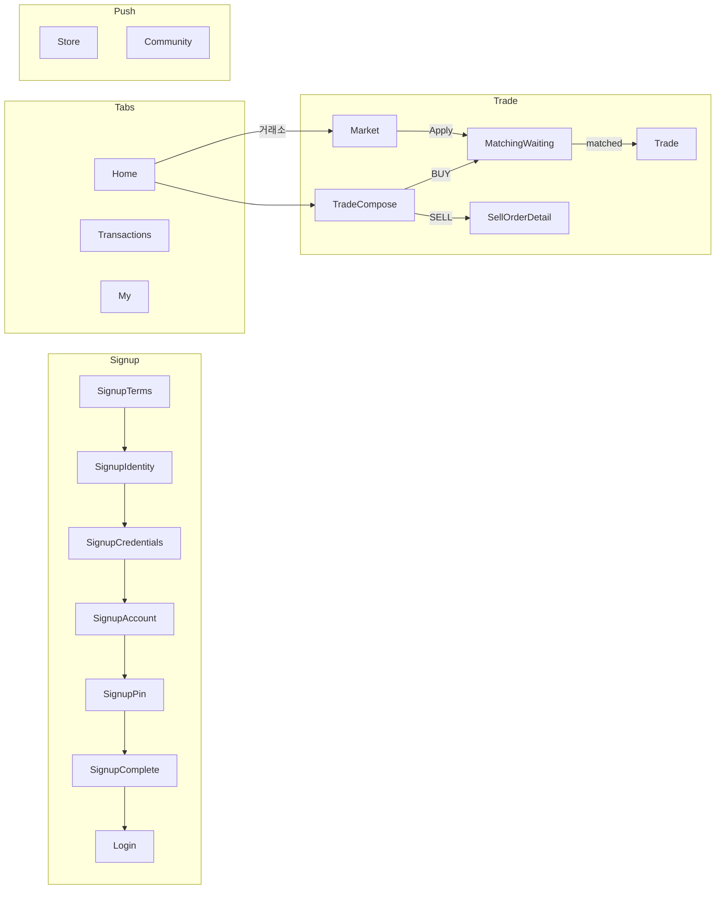
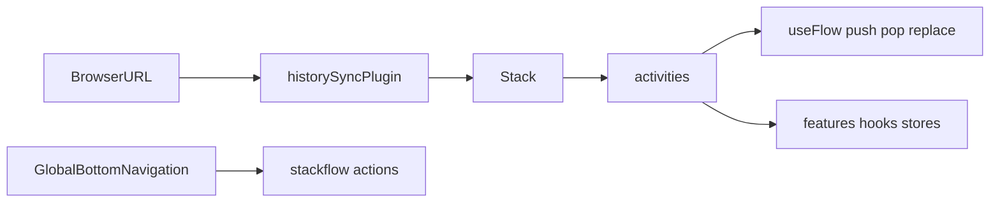

# Stackflow 팀 가이드

Brit은 **Next.js App Router가 아니라 Stackflow**로 화면 전환을 처리합니다.  
Activity = 한 화면(또는 한 URL) 단위 컴포넌트입니다.

공식 문서: https://stackflow.so/ko

## 화면 지도

폴더 순서가 아니라 **아래 플로우**가 Activity 순서의 정본입니다. route·params는 [화면 맵](#화면-맵-activity--route) 참고.



| 플로우 | Activity 순서 | 상세 문서 |
|--------|---------------|-----------|
| 가입 | Terms → Identity → Credentials → Account → Pin → Complete(PENDING) → Login | [auth.md](../domains/auth.md) |
| 로그인 | Login (아이디+비번 Primary / 패스키 Secondary) | [auth.md](../domains/auth.md) |
| 거래 | Home → TradeCompose → MatchingWaiting(BUY) / SellOrderDetail(SELL) → Trade(입금·분할) | [trade.md](../domains/trade.md) |
| 탭 | Home / Transactions / My (`actions.replace`) | 하단 탭 |
| 푸시 | Store, Community — 하단 탭 없음 | 매칭 중 탐색 |
| DEV | `SmsSchemePoc` (`/poc/sms`) — 프로덕션 UX 아님 | DEV Fab |

## 개념

| 개념 | 설명 | 이 프로젝트 위치 |
|------|------|------------------|
| Activity | Stack에 쌓이는 화면 단위 | `src/activities/*.tsx` |
| Stack | Activity 스택 + 전환 애니메이션 | `src/stackflow/stackflow.ts` → `<Stack />` |
| config / Register | Activity 이름·route·params 타입 | `src/stackflow/config.ts` |
| `useFlow()` | Activity **내부**에서 push/pop/replace | 각 Activity, feature hook |
| `actions` | Stack **밖** 크롬에서 네비게이션 | `GlobalBottomNavigation`, `SignupCompleteActivity` |
| historySync | URL ↔ Stack 동기화 | `historySyncPlugin` in `stackflow.ts` |



## 파일 맵

| 파일 | 역할 |
|------|------|
| [`src/stackflow/config.ts`](../../src/stackflow/config.ts) | route 정의, `Register` params 타입 |
| [`src/stackflow/stackflow.ts`](../../src/stackflow/stackflow.ts) | Stack 생성, plugins, `components` 등록 |
| [`src/activities/`](../../src/activities/) | Activity 컴포넌트 |
| [`src/App.tsx`](../../src/App.tsx) | `<Stack initialContext={...} />` 마운트 |

## 화면 맵 (Activity ↔ route)

| Activity | Route | Params |
|----------|-------|--------|
| `Home` | `/` | — (탭) |
| `Transactions` | `/transactions` | — (탭) |
| `My` | `/my` | — (탭) |
| `Store` | `/store` | — (푸시, 탭 없음) |
| `Community` | `/community` | — (푸시, 탭 없음) |
| `TradeCompose` | `/trade/compose` | `side: 'BUY' \| 'SELL'` |
| `Market` | `/market` | — (공개 매도 browse) |
| `MatchingWaiting` | `/trade/matching/:buyOrderId` | `buyOrderId`, `tradeId?`, `requestedAmountKrw?`, `initialPhase?`, `tradeRequestId?` |
| `SellOrderDetail` | `/trade/sell/:sellOrderId` | `sellOrderId`, `entryContext?` |
| `Trade` | `/trade` | `tradeId?`, `splitGroupId?`, `focusLeg?` |
| `DisputeChat` | `/trade/dispute/:disputeId` | `disputeId` |
| `SignupTerms` | `/auth/signup/terms` | — |
| `SignupIdentity` | `/auth/signup/identity` | — |
| `SignupCredentials` | `/auth/signup/credentials` | `step?: SignupCredentialsStep` |
| `SignupAccount` | `/auth/signup/account` | `step?: SignupAccountStep` |
| `SignupPin` | `/auth/signup/pin` | `step?: SignupPinStep` |
| `SignupComplete` | `/auth/signup/complete` | — (승인 대기 → Login) |
| `RegistrationStatus` | `/auth/registration-status` | `mode?: 'wait' \| 'resubmit'` |
| `Login` | `/auth/login` | — |
| `SecuritySettings` | `/auth/security` | — |
| `NotificationSettings` | `/auth/notifications` | — |
| `NotificationCenter` | `/notifications` | — |
| `AccountRecovery` | `/auth/recovery` | `step?: AccountRecoveryStep` |
| `SmsSchemePoc` | `/poc/sms` | — (DEV 전용) |
| `NotFound` | `/404` | — |

레거시: `/detail/transactions` → `/transactions`, `/detail/store` → `/store`, `/detail/community` → `/community`, `/detail/profile` → `/my`.

가입 플로우 상세: [docs/domains/auth.md](../domains/auth.md)

### Trade 라우트 예시

홈 퀵액션(구매/판매) → `push('TradeCompose', { side })` → 확인 후 `replace`.

- 금액 입력: `/trade/compose?side=BUY` (또는 `SELL`)
- 구매 매칭: `/trade/matching/:buyOrderId`
- 판매 운영: `/trade/sell/:sellOrderId`
- 입금·분할: `/trade?tradeId=...` 또는 `/trade?splitGroupId=split-xxx`
- leg 딥링크: `/trade?splitGroupId=split-xxx&focusLeg=2`

## Activity 내부 vs Stack 밖

### Activity 안 — `useFlow()`

```tsx
import { useFlow, useActivityParams } from '@stackflow/react'

const { push, pop, replace } = useFlow()
const { step } = useActivityParams<'SignupPin'>()

// 다음 화면
push('SignupCredentials', { step: 'loginId' })

// 히스토리 정리 (PIN confirm → create 복귀)
replace('SignupPin', { step: 'create' })

// 뒤로
pop()
```

### Stack 밖 — `actions`

탭 바, 글로벌 배너 등 Activity 트리 밖에서 이동할 때:

```tsx
import { actions } from '../stackflow/stackflow'

actions.replace('Home', {}, { animate: false })
actions.push('SignupTerms', {})
actions.pop(popCount, { animate: false })
```

예시:
- [`GlobalBottomNavigation.tsx`](../../src/app/layouts/GlobalBottomNavigation.tsx)
- [`SignupCompleteActivity.tsx`](../../src/activities/auth/SignupCompleteActivity.tsx)

## 새 Activity 추가 (5단계)

1. **`config.ts`** — `Register`에 Activity 이름·params 추가 + `activities` 배열에 `route`
2. **`src/activities/MyActivity.tsx`** — `ActivityComponentType<'MyActivity'>` 구현
3. **`stackflow.ts`** — `components: { MyActivity: MyActivity, ... }` 등록
4. **이동 코드** — `push('MyActivity', { ... })` (params는 Register와 일치)
5. **문서** — 이 파일의 화면 맵 + 필요 시 `docs/domains/*` 업데이트

## push / pop / replace 선택

| API | 사용 시점 |
|-----|-----------|
| `push` | 새 화면을 스택에 쌓음 (일반 forward) |
| `pop` | 이전 Activity로 (뒤로가기) |
| `replace` | 현재 Activity를 교체 (히스토리에 남기지 않음) — PIN confirm, 탭 전환, 가입 완료 후 Home |

## 뒤로·닫기 규칙

화면 역할을 먼저 정하고, 나가는 도착지는 **항상 바로 아래 Activity**로 맞춘다. 헤더 버튼·스와이프·하드웨어 뒤로가 같은 곳으로 가야 한다.

| 역할 | 화면 | 진입 | 뒤로·닫기 |
|------|------|------|-----------|
| 탭 루트 | Home · Transactions · My | 하단 탭 `replace` | 없음 |
| 허브 | Market · SellOrderDetail(이력) · NotificationCenter | `push` | `goBack()` |
| 흐름 | TradeCompose → MatchingWaiting → Trade | 허브·홈에서 `push`, 흐름 내부 단계는 `replace` | X = `goBack()` (흐름 시작 화면으로) |
| 단계 | Signup · PIN · 계좌 변경 | step `replace` | 이전 step 또는 흐름 종료 |

- 헬퍼: [`src/stackflow/navigation.ts`](../../src/stackflow/navigation.ts)
  - `goBack()` — `pop`. 스택 첫 화면이면 루트 Home으로 정리
  - `exitTo('Market' | 'Home')` — 아래에서 가장 가까운 target까지 `pop`. 없으면 target으로 대체
- `navigateToRootHome`은 「홈으로」처럼 **명시적인 버튼에만** 쓴다. 닫기(X) 핸들러에 쓰지 않는다.
- 헤더 `onBack`/`onClose`는 확인 다이얼로그용이다. 도착지를 바꾸지 않는다.
- 새로고침·URL 직접 진입: 허브·흐름 route에 `defaultHistory: under('Home' | 'Transactions' | 'My')`를 둬서 루트 탭을 아래에 깐다 ([`config.ts`](../../src/stackflow/config.ts)). 새 허브·흐름 Activity를 추가할 때도 같이 넣는다.
- 그래도 스택 첫 화면이면 Seed `AppBarBackButton`이 숨는다. `ActivityScreenLayout`이 대신 뒤로 버튼을 그리고 `goBack()`(→ Home)으로 보낸다.
- 하드웨어·브라우저 뒤로: `useBackGuard(enabled, onBack)` ([`backGuard.ts`](../../src/stackflow/backGuard.ts)). enabled인 동안 최상단이면 popstate를 멈추고 한 칸 되돌린 뒤 `onBack`(확인 다이얼로그 등)을 실행한다. 헤더 X와 같은 핸들러를 넘긴다. 스와이프는 `preventSwipeBack`으로 막는다. 화면별 이탈 규칙은 Activity가 아니라 훅에 둔다 (예: [`useMatchingWaitingExit`](../../src/features/orders/hooks/useMatchingWaitingExit.ts)).
- 거래소 → 거래 요청은 대기 화면을 `push`한다. 요청이 끝나면 `exitTo('Market')`로 기존 거래소에 돌아간다(스크롤·정렬 유지, 복귀 시 목록 조용히 갱신).

## Activity vs BottomSheet

| 전체 화면 | 맥락 내 오버레이 |
|-----------|------------------|
| Activity (`push`) | BottomSheet / AlertDialog |
| URL 공유·딥링크 필요 | 같은 Activity 안 흐름 |

Consumer UX: **진입 직후** 전면 BottomSheet 금지. 거래 맥락 내 시트만.

## Activity 작성 패턴 (권장)

```tsx
/**
 * MyActivity — 화면 조립만.
 * @see docs/stackflow/README.md
 */
const MyActivity: ActivityComponentType<'MyActivity'> = () => {
  const screen = useMyScreen() // features/*/hooks/
  return <MyScreenLayout {...screen} />
}
```

- orchestration·effect는 `useMyScreen` hook으로
- 목표: Activity **80~120줄** (JSX 위주)
- 참고: [`HomeActivity`](../../src/activities/HomeActivity.tsx) + [`useHomeScreen`](../../src/features/home/hooks/useHomeScreen.ts)

## `useActivity` / `isActive`

백그라운드 Activity에서 effect가 돌지 않게 할 때:

```tsx
const { isActive } = useActivity()
useEffect(() => {
  if (!isActive) return
  // ...
}, [isActive])
```

## 안티패턴

- Activity 200줄+ 에 effect·handler·store 호출 혼재
- `window.location` / `history.pushState` 직접 조작 (`useFlow` / `actions` 사용)
- URL params와 store 상태 불일치 (`Register` 타입 미갱신)
- Activity마다 다른 네비 패턴 (팀 레시피 통일)

## 관련 문서

- [docs/architecture/overview.md](../architecture/overview.md)
- [docs/adr/001-stackflow-navigation.md](../adr/001-stackflow-navigation.md)
- [docs/domains/trade.md](../domains/trade.md)
